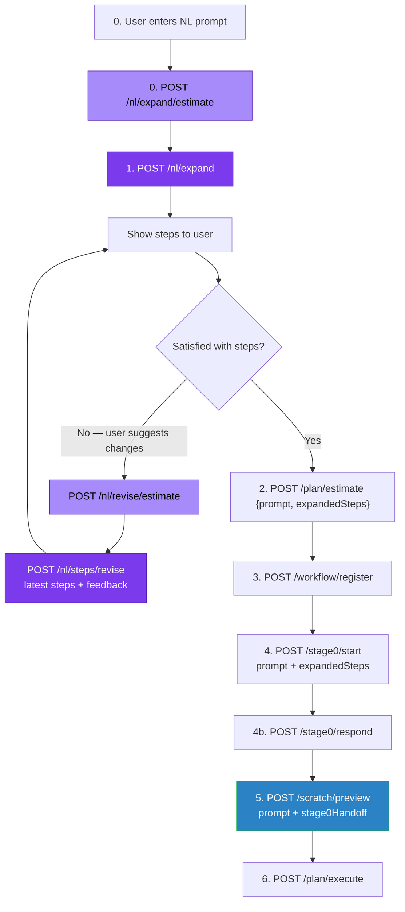

# Natural Language Workflow Builder (NL Builder) — Architecture & Implementation Guide

## Overview

The **Natural Language Workflow Builder (NL Builder)** allows users to create complex agentic workflows using a single natural language description instead of manually defining steps, phases, and nodes.

It integrates seamlessly with the existing stage0 clarification engine, scratch graph planner, billing system, and gap resolution pipeline.

**Frontend binding (prompt mode):** see [`NL_BUILDER_FRONTEND_GUIDE.md`](./NL_BUILDER_FRONTEND_GUIDE.md) for call order, state to hold, payloads, and UX checklist.

---

## Endpoint Reuse Strategy

To avoid code duplication, the NL Builder **reuses existing endpoints** for full-pipeline estimate, Stage 0, preview, and execute, and adds expand / step-revise (+ their LLM cost estimates) **before** Stage 0.

**Billing note:** `/workflow/register` must run **before** Stage 0. Calling `/stage0/start` on an unregistered project returns `WORKFLOW_NOT_REGISTERED`.



### Summary of Endpoint Roles

| Flow Step | Endpoint | Method | Status | Purpose |
|-----------|----------|--------|--------|---------|
| **0. Expand LLM cost** | `/aiqod-agent/agent/agentic/nl/expand/estimate` | `POST` | **NEW** | No LLM. Predicted Gemini cost of one `/nl/expand`. |
| **1. Expand steps** | `/aiqod-agent/agent/agentic/nl/expand` | `POST` | **NEW** | `{prompt}` → first step list. Show to the user. |
| **1b. Revise LLM cost** | `/aiqod-agent/agent/agentic/nl/revise/estimate` | `POST` | **NEW** | No LLM. Predicted cost of one `/nl/steps/revise` (alias: `/nl/steps/revise/estimate`). |
| **1c. Revise steps (loop)** | `/aiqod-agent/agent/agentic/nl/steps/revise` | `POST` | **NEW** | Repeat: `{prompt, steps: latest, feedback}` → new list until the user is satisfied. |
| **2. Pre-plan estimate** | `/aiqod-agent/agent/agentic/plan/estimate` | `POST` | Existing | `{prompt, expandedSteps}` — **full remaining** workflow (Stage 0 + scratch + execute). Same estimator as steps mode. |
| **3. Admission / register** | `/aiqod-agent/agent/agentic/workflow/register` | `POST` | Existing | Reserve `predictedCost`. **Required before Stage 0.** |
| **4a. Start clarification** | `/aiqod-agent/agent/stage0/start` | `POST` | Existing | `{prompt, expandedSteps}` — skips expander when `expandedSteps` is sent. |
| **4b. Answer questions** | `/aiqod-agent/agent/stage0/respond` | `POST` | Existing | Until `status=complete` (`sessionId` only here) |
| **5. Plan + refine execute cost** | `/aiqod-agent/agent/agentic/plan/scratch/preview` | `POST` | Existing | `{prompt, stage0Handoff}`. Returns `phaseGraphs` + topology-based remaining `estimatedCost`. |
| **6. Execute** | `/aiqod-agent/agent/agentic/plan/execute` | `POST` | Existing | Gap codegen |

### Cost model (both modes)

After expand/revise, prompt mode has a step list — same input as steps mode. `/plan/estimate` therefore uses the **same full-pipeline heuristic** in both modes:

`predictedCost` ≈ Stage 0 clarification + scratch LangGraph (skeleton, enricher, schemas, routers) + execute/gap codegen (GENERATE UI screens + tools) × safety buffer (~1.4).

| When | Call | What `predictedCost` / `estimatedCost` means |
|------|------|-----------------------------------------------|
| Before expand / each revise | `/nl/expand/estimate` or `/nl/revise/estimate` | **That one Gemini call only** (defaults + optional `llm_token_count` averages). Not part of the workflow reservation. |
| After confirmed steps | `POST /plan/estimate` `{prompt, expandedSteps}` | **Full remaining workflow** (`stage0CostUsd` + `previewCostUsd` + `executeCostUsd`). Expand/revise spend is already billed and is **not** reserved again. Prompt-only body (no `expandedSteps`) → **400**. |
| After `/scratch/preview` | response `estimatedCost` | Refined remaining **execute** from real GENERATE ui/tool counts |
| After plan | update reservation | Raise hold if topology execute exceeds the pre-plan `executeCostUsd` slice |

Steps mode: `/plan/estimate` `{steps}` — same function; topology from each step's `preferredKind` (`ui_screen` / `tool` lock 1 node; `null` may split).

`/nl/plan/revise` still exists for **after-preview graph** edits. Do not use it to change the step list.

Enterprise steps are **capability-only**: `stepId`, `name`, `description`, `preferredKind`. Expander does **not** invent `inputs`/`outputs` (Stage 2 bindings). API may still return empty arrays for compatibility.

---

## Detailed API Specification

### 0. `POST /aiqod-agent/agent/agentic/nl/expand/estimate`

No Gemini call. Same body as `/nl/expand`.

```json
{
  "prompt": "Build a production-ready invoice processing and AP approval workflow",
  "projectId": "...",
  "subscriberId": "..."
}
```

Response (`NLLlmCallEstimateResponse`): `{ operation:"expand", endpoint, model, predictedCost, estimatedCostUsd, inputTokens, outputTokens, totalTokens, source, sampleCount, observedAvgCostUsd, assumptions, ... }`.

`source`: `observed` (≥3 successful `llm_token_count` rows for `prompt-to-enterprise-steps`), `blended` (fewer samples), or `default` (heuristic for `gemini-3.1-pro-preview`).

### 1. `POST /aiqod-agent/agent/agentic/nl/expand`

```json
{
  "prompt": "Build a production-ready invoice processing and AP approval workflow",
  "projectId": "507f1f77bcf86cd799439011",
  "orgId": "...",
  "subscriberId": "...",
  "userId": "..."
}
```

Response: `{ prompt, steps, stepCount, source, warnings }`. Show this list in the UI. Empty expand → `422` `enterprise_expand_empty`.

### 1b. `POST /aiqod-agent/agent/agentic/nl/revise/estimate`

No Gemini call. Same body as `/nl/steps/revise`. Alias: `/nl/steps/revise/estimate`.

### 1c. `POST /aiqod-agent/agent/agentic/nl/steps/revise` (repeat until satisfied)

Stateless loop. Each call takes the **latest** `steps` from the previous expand/revise response plus new `feedback`. There is no session. Repeat as many times as the user wants:

1. Show `steps` to the user.
2. Optionally `POST /nl/revise/estimate` for that round’s LLM cost.
3. User types a change → `POST /nl/steps/revise` with that list + `feedback`.
4. Replace UI list with the response `steps`.
5. Repeat until the user confirms. Then send that final list as `expandedSteps` to `/plan/estimate` and `/stage0/start`.

```json
{
  "prompt": "Build a production-ready invoice processing and AP approval workflow",
  "feedback": "Add a 3-way match exception queue before department approval.",
  "steps": [ ]
}
```

Same response as expand, plus `feedback`. Always POST the full current list, not a delta.

### 2. `POST /aiqod-agent/agent/agentic/plan/estimate`

```json
{
  "prompt": "Build a production-ready invoice processing and AP approval workflow",
  "expandedSteps": [ /* confirmed steps */ ],
  "projectId": "...",
  "orgId": "...",
  "subscriberId": "...",
  "userId": "..."
}
```

Requires `expandedSteps` in prompt mode. Returns `predictedCost`, `stage0CostUsd`, `previewCostUsd`, `executeCostUsd`, `uiScreenCount`, `toolCount`, etc.

Then `/workflow/register` with that `predictedCost`, then `/stage0/start`:

```json
{
  "prompt": "Build a production-ready invoice processing and AP approval workflow",
  "expandedSteps": [ ],
  "projectId": "...",
  "mode": "prompt"
}
```

### 3. `POST /aiqod-agent/agent/agentic/plan/scratch/preview` (prompt + steps)

**Preferred planner for both modes.**

#### Prompt mode (after Stage 0)
```json
{
  "prompt": "Build a production-ready contract digitization workflow",
  "mode": "prompt",
  "projectId": "507f1f77bcf86cd799439011",
  "orgId": "507f1f77bcf86cd799439012",
  "subscriberId": "507f1f77bcf86cd799439013",
  "userId": "507f1f77bcf86cd799439014",
  "selectedName": "Customer Onboarding Workflow",
  "selectedType": "automation",
  "selectedCategory": "finance",
  "stage0Handoff": { "requirementSummary": { /* from /stage0/respond complete — includes steps */ } }
}
```

Response is `AgenticPlanPreviewResponse` with `phaseGraphs` ready for `/plan/execute`, plus prompt extras: `estimatedCost`, `costEstimate`.

No `sessionId` on preview. Stage 0 still uses `sessionId` for `/stage0/respond` only.

#### Steps mode
```json
{
  "steps": [ /* AgenticPhaseStep[] */ ],
  "projectId": "...",
  "mode": "steps",
  "stage0Handoff": { "requirementSummary": { /* from /stage0/respond */ } }
}
```

### 3b. `POST /aiqod-agent/agent/agentic/nl/plan` (alias)

Same planning as prompt-mode scratch/preview; returns `NLPlanResponse` for revise/UI that still expect it. Prefer `/scratch/preview` for new clients.

#### Request Payload (`NLPlanRequest`)
```json
{
  "sessionId": "stage0_sess_1730000000000_abc123",
  "projectId": "507f1f77bcf86cd799439011",
  "orgId": "507f1f77bcf86cd799439012",
  "subscriberId": "507f1f77bcf86cd799439013",
  "userId": "507f1f77bcf86cd799439014",
  "selectedName": "Customer Onboarding Workflow",
  "selectedType": "automation",
  "selectedCategory": "finance"
}
```

#### Response Payload (`NLPlanResponse`)
```json
{
  "sessionId": "stage0_sess_1730000000000_abc123",
  "status": "plan_ready",
  "workflowId": "agentic_1730000000000_xyz",
  "workflowName": "Customer Onboarding Workflow",
  "plan": {
    "summary": "This workflow collects customer details via a UI screen, verifies identity credentials using an external OCR tool, and routes approval based on verification results.",
    "phases": [
      {
        "phaseId": "phase_1",
        "phaseName": "Identity & Verification",
        "description": "Capture user info and run verification checks",
        "nodes": [
          {
            "nodeId": "collect_info_ui",
            "name": "Collect Customer Information",
            "type": "ui_screen",
            "description": "Displays form for full name, email, and ID card upload."
          }
        ]
      }
    ],
    "nodeCount": 4,
    "edgeCount": 4,
    "uiScreenCount": 1,
    "toolCount": 2,
    "routerCount": 1
  },
  "phaseGraphs": [ /* PhaseGraphResult[] for /plan/execute */ ],
  "steps": [ /* LogicalStep[] */ ],
  "estimatedCost": 1.25,
  "costEstimate": {
    "estimateKind": "topology_execute",
    "predictedCost": 1.25,
    "executeCostUsd": 0.89,
    "uiScreenCount": 1,
    "toolCount": 2,
    "nodeCount": 4,
    "edgeCount": 4,
    "routerCount": 1,
    "stages": []
  },
  "subscriberAvailableUsd": 5000.0,
  "sufficientBalance": true,
  "mode": "prompt",
  "analysis_source": "llm",
  "warnings": []
}
```

---

### 4. `POST /aiqod-agent/agent/agentic/nl/plan/revise`

Revises the **LangGraph after preview** (`sessionId` + stored plan). To change the **step list before Stage 0**, use `/nl/steps/revise` instead.

#### Request Payload (`NLPlanReviseRequest`)
```json
{
  "sessionId": "stage0_sess_1730000000000_abc123",
  "feedback": "Add an automated email notification step right after identity verification succeeds.",
  "projectId": "507f1f77bcf86cd799439011",
  "orgId": "507f1f77bcf86cd799439012",
  "subscriberId": "507f1f77bcf86cd799439013",
  "userId": "507f1f77bcf86cd799439014"
}
```

#### Response Payload (`NLPlanResponse`)
Returns an updated `NLPlanResponse` with `status: "plan_revised"`, containing updated `plan` summary/nodes, updated `phaseGraphs`, and re-calculated `estimatedCost`.

---

## Plan Generation Logic (enterprise steps → Stage 1 via `/scratch/preview`)

Primary planner for **both** modes is **`POST /agentic/plan/scratch/preview`**:

| Mode | Request | What runs |
|------|---------|-----------|
| **steps** | `{steps, stage0Handoff?}` | Per-phase `plan_phase_graph_scratch` |
| **prompt** | `{prompt, stage0Handoff?, projectId}` | `requirementSummary.steps` (from expand + Stage 0) → same scratch Stage 1 |

`/nl/plan` remains a **thin alias** returning `NLPlanResponse` for revise/UI that still expect it.

Prompt mode does **not** wrap the whole prompt as one FREE blob (that was the
failure mode that collapsed KYC to 4–6 nodes):

1. **`POST /nl/expand`** the user NL into production-ready enterprise logical steps
   (`enterprise_expander.py`, typically 8–18 steps). Optional **`/nl/steps/revise`**.
   `preferredKind` is usually `null` (FREE) so Stage 1 can split and add routers.
   Fewer than 6 steps on first expand is treated as expander failure.
2. **Stage 0** (`prompt` + `expandedSteps`) clarifies **those** steps (credentials,
   collection names, review vs auto, providers). Clarifications are attached onto
   the step specs so Stage 1 cannot ignore them.
3. **`/scratch/preview` with `{prompt, stage0Handoff}`** runs Stage 1 (`plan_phase_graph_scratch`)
   on the expanded steps. Stage 1.2 enriches node descriptions; 1.5–4c enrich bindings,
   persistence, and routers.
4. Preview returns remaining-execute cost from the assembled graph (`estimatedCost`).
5. Persist to `Process_Configs` the same preview shape as steps-mode scratch preview.

If expansion fails and Stage 0 is started without `expandedSteps`, Stage 0 may expand
internally; planning can fall back to one FREE blob (legacy). Prefer always sending
caller `expandedSteps`. Steps mode is unchanged: caller-supplied steps, no expander.

`analyze_requirements_with_llm()` remains for `/requirements/analyze` and the
legacy bare-`prompt` scratch path only. Do not reuse it for NL after Stage 0.

## Plan Revision Logic (Dual Path)

When a user submits feedback, `plan_reviser.py` uses an LLM call to classify the request into one of two paths:

1. **Structural Path**:
   - **Triggers**: Adding, deleting, splitting, or re-ordering steps/phases/nodes.
   - **Action**: Re-expands to enterprise steps from original prompt + current plan summary + revision request, then re-runs Stage 1.

2. **Detail Path**:
   - **Triggers**: Modifying screen field labels, tool APIs, validation rules, or DB schemas.
   - **Action**: Performs targeted updates to `generationDescription` and node parameters in the existing `phaseGraphs` without invalidating the topology.

---

## File Structure & Module Organization

All new code is isolated inside `backend/nl_builder/` to keep `agent_new.py` clean.

```
backend/
├── nl_builder/                          # Dedicated NL Builder module
│   ├── __init__.py
│   ├── models.py                        # Pydantic request/response schemas
│   ├── enterprise_expander.py           # Prompt → enterprise logical steps (before Stage 0)
│   ├── plan_generator.py                # Expanded steps → Stage 1 skeleton / scratch pipeline
│   ├── plan_reviser.py                  # Classification & dual-path plan revision
│   ├── process_configs.py               # Persist NL preview into Process_Configs
│   └── router.py                        # /nl/expand[/estimate], /nl/revise/estimate,
│                                        # /nl/steps/revise[/estimate], /nl/plan, /nl/plan/revise
├── services/
│   └── plan_credit_estimator.py         # Full-pipeline + expand/revise LLM cost heuristics
├── docs/
│   ├── NL_BUILDER_README.md
│   └── NL_BUILDER_FRONTEND_GUIDE.md
└── agent_new.py                         # Mounts nl_router; /plan/estimate, Stage 0, scratch/preview
```

---

## Integration Checklist

- [x] Create `backend/nl_builder/` package and files (`models.py`, `plan_generator.py`, `plan_reviser.py`, `router.py`).
- [x] Implement `enterprise_expander.py` + `/nl/expand` + `/nl/steps/revise` (capability-only steps).
- [x] Implement `/nl/expand/estimate` + `/nl/revise/estimate` (defaults + `llm_token_count`).
- [x] Wire `/plan/estimate` to full-pipeline heuristic with `expandedSteps`.
- [x] Implement `plan_generator.py` using expanded enterprise steps and `plan_phase_graph_scratch()`.
- [x] Implement `plan_reviser.py` with structural and detail revision branches.
- [x] Mount `nl_router` in `backend/agent_new.py`.
- [x] Document frontend prompt-mode binding (`NL_BUILDER_FRONTEND_GUIDE.md`).
