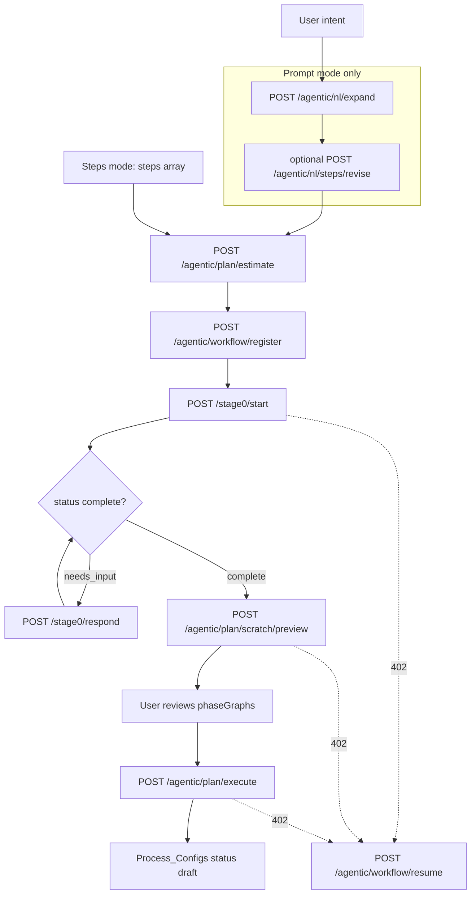

# Workflow Builder — Knowledge Transfer

**Audience:** Engineers joining the team to work on the workflow builder (backend, debugging, and how the frontend should call it).

**This is the KT document.** It was checked against the code on 8 Oct 2026. Function names are the stable anchors. Line numbers drift; search for the function if a line no longer matches.

**Base path:** `{BASE}/aiqod-agent/agent`  
Example: `http://localhost:5010/dev/aiqod-agent/agent`

**Stable id:** `projectId` === `workflowId`. One MongoDB document in `Process_Configs` (`engineType: "agentic_graph"`, `agentic_process.workflow_id`) for the whole build.

---

## Which older doc to use

| Document | Use it for | Do not use it as the KT because |
|----------|------------|----------------------------------|
| **This file** | End-to-end build flow, files, main functions, where to debug | — |
| [`docs/WORKFLOW_BUILDER_FLOW_GUIDE.md`](../WORKFLOW_BUILDER_FLOW_GUIDE.md) | Short onboarding narrative and billing summary | Too thin for debugging; prompt-mode `/nl/expand` was missing until the pointer added with this update |
| [`docs/prompt-builder/WORKFLOW_BUILDER_CREDIT_FLOW_README.md`](../prompt-builder/WORKFLOW_BUILDER_CREDIT_FLOW_README.md) | Wallet, 402, resume, progress fields | Billing only; does not walk the planner or generators |
| [`docs/prompt-builder/WORKFLOW_BUILDER_BACKEND_FRONTEND_README.md`](../prompt-builder/WORKFLOW_BUILDER_BACKEND_FRONTEND_README.md) | Canvas binding, request field tables, runtime screens | **Call order is stale.** It starts at `/stage0/start` and estimates after Stage 0. Current order is estimate → register → Stage 0 |
| [`docs/architecture-review/WORKFLOW_GENERATOR_DEEP_ARCHITECTURAL_REVIEW.md`](WORKFLOW_GENERATOR_DEEP_ARCHITECTURAL_REVIEW.md) | Why generated screens/tools can pass validation and still be wrong | Failure analysis, not an onboarding walkthrough |
| `docs/prompt-builder/WORKFLOW_*` | Async jobs, timeouts, frontend progress, credits | One concern each |

The product path below is the **scratch** planner (`/plan/scratch/preview`). There is also `POST /agentic/plan/preview`, which matches existing capabilities. New workflow builds do not use that path.

---

## 1. What the builder does

It turns a user’s intent into a runnable multi-phase LangGraph workflow:

- A graph per phase (nodes, edges, bindings, routers)
- Generated UI screens (Angular + IR + Python backend functions) where a node is `GENERATE` of kind `ui_screen`
- Generated dynamic tools (LLM-written Python, registered as `tool:*`) where a node is `GENERATE` of kind `tool`
- Combined LangGraph Python saved on disk and pointed at from `Process_Configs.agentic_process.combined_file_path`
- Status `draft` when the build succeeds

The pipeline is split so the user can see cost, clarify requirements, review the graph, and only then pay for heavy codegen. Mid-build credit exhaustion writes a checkpoint and returns HTTP 402. `POST /agentic/workflow/resume` continues from that checkpoint.

Build and run are separate. This document’s main path ends when execute persists `status: "draft"`. Running that workflow is `langgraph/app/executor.py`.

---

## 2. Required call order

### Prompt mode

The user typed one free-text prompt. `/nl/expand` is required before estimate. Step mode skips it.

```text
POST /agentic/nl/expand
        optional, repeatable: POST /agentic/nl/steps/revise
POST /agentic/plan/estimate          body: { prompt, expandedSteps }
POST /agentic/workflow/register      predictedCost from estimate; reserveSubscriberCredits: true
POST /stage0/start                   same prompt + expandedSteps + projectId
POST /stage0/respond                 loop until status = "complete"
        optional: POST /stage0/guidance
POST /agentic/plan/scratch/preview   prompt + stage0Handoff
POST /agentic/plan/execute           phaseGraphs from preview, unchanged
```

`/plan/estimate` **rejects** prompt mode unless `expandedSteps` is present. Expand/revise LLM cost is already spent and is not included again in `predictedCost`.

If the UI skips `/nl/expand` and calls `/stage0/start` with only `prompt`, Stage 0 expands internally. That still works, but the cost screen cannot match the confirmed step list, so the product sequence is expand first.

### Steps mode

The user already built phases and sub-steps in the UI. Do not call `/nl/expand`.

```text
POST /agentic/plan/estimate          body: { steps }
POST /agentic/workflow/register
POST /stage0/start                   { steps, projectId }
POST /stage0/respond                 until status = "complete"
POST /agentic/plan/scratch/preview   { steps, stage0Handoff }
POST /agentic/plan/execute
```

Exactly one of `prompt` or `steps` on Stage 0, estimate, and preview. Both set, or neither set, is HTTP 400. Exception: dashboard-only callers may send `suggestedReports` alone to `/stage0/start`.

### Headers on billed calls

| Field | Body | Header fallback |
|-------|------|-----------------|
| Organization | `orgId` | `x-org-id` |
| Subscriber | `subscriberId` | `x-subscriber-id` |
| User | `userId` | `x-user-id` |

`projectId` returned by register is reused on Stage 0, preview, and execute.



---

## 3. What each step does

| Step | Endpoint | Handler | LLM | Writes |
|------|----------|---------|-----|--------|
| Expand | `POST /agentic/nl/expand` | `nl_builder/router.py` `expand_prompt_endpoint` | Yes | None required. Returns steps for the UI |
| Revise | `POST /agentic/nl/steps/revise` | `nl_builder/router.py` | Yes | None. Replacement step list |
| Estimate | `POST /agentic/plan/estimate` | `agent_new.plan_estimate` | No | None |
| Register | `POST /agentic/workflow/register` | `agent_new.workflow_register` | No | `Process_Configs` billing shell; optional wallet hold |
| Stage 0 start | `POST /stage0/start` | `agent_new.stage0_start` | Yes | Redis session `stage0_*` (30 min). Status `stage0_in_progress` |
| Stage 0 respond | `POST /stage0/respond` | `agent_new.stage0_respond` | Yes | Same session |
| Guidance | `POST /stage0/guidance` | `agent_new` | 0–1 | Does not advance the QnA turn |
| Preview | `POST /agentic/plan/scratch/preview` | `agent_new.agentic_plan_scratch_preview` | Yes | `Process_Configs` status `preview`; checkpoint |
| Execute | `POST /agentic/plan/execute` | `agent_new.agentic_plan_execute` | Yes, heavy | Screens, tools, LangGraph file, status `draft` |
| Resume | `POST /agentic/workflow/resume` | `agent_new` | Continues the paused step | Reads `workflow_build_checkpoints` |
| Progress | `POST /agentic/workflow/progress` | `agent_new` | No | Read-only |

### 3.1 `/agentic/nl/expand` — prompt → enterprise steps

`expand_prompt_to_enterprise_steps` in `backend/nl_builder/enterprise_expander.py` turns the prompt into a flat `LogicalStep[]`. Each step has `stepId`, `name`, `description`, and `preferredKind` (`ui_screen` or `tool`). I/O is not planned here. The scratch planner owns inputs and outputs later.

The UI shows the steps. If the user edits them, call `/nl/steps/revise` and keep the latest list. Pass that list as `expandedSteps` into estimate, Stage 0, and (via the Stage 0 summary) preview.

Empty expansion is HTTP 422 `enterprise_expand_empty`.

### 3.2 `/agentic/plan/estimate` — price only

`estimate_workflow_cost` in `backend/services/plan_credit_estimator.py` is heuristic math: phase/step counts, UI vs tool mix, Stage 0 + preview + execute token guesses, USD. No LLM. No Mongo.

Prompt mode wraps `expandedSteps` with `estimator_phases_from_logical_steps`. Steps mode uses the `steps` array and each step’s `preferredKind`.

Important response fields:

- `predictedCost` — pass this to register as the workflow cap
- `stage0CostUsd`, `previewCostUsd`, `executeCostUsd`
- `sufficientBalance` / `subscriberAvailableUsd`

### 3.3 `/agentic/workflow/register` — open the workflow record

`register_workflow_process_config` in `backend/services/workflow_budget_service.py`:

- Creates or updates `Process_Configs` for `projectId`
- Stores `predictedCost`
- With `reserveSubscriberCredits: true`, increments `subscribers.AICredits.reserved` by that amount

Errors: 402 if the wallet cannot cover the hold; 409 if the workflow is already registered with a different `predictedCost`.

Every later LLM call charges this cap first (`budgetSpentUsd`), then the wallet (`overflowSpentUsd`).

### 3.4 Stage 0 — clarify and check credentials

Stage 0 runs **before** the graph exists. It does not plan nodes.

`stage0_start` (`agent_new.py` ~12114):

1. Prompt mode: use `expandedSteps` if present. Otherwise call `expand_prompt_to_enterprise_steps` again. Steps mode converts `request.steps` with `_stage0_phases_to_logical_steps`. No expander.
2. Sub-phase **0-A:** `fetch_configured_secrets` — secret **names** only, never values.
3. Sub-phase **0-B:** first MCQ turn via `run_stage0b_single_turn`.
4. Creates Redis session `stage0_<id>`.

Response `status`:

- `needs_input` — show `questions[]`
- `complete` — `requirementSummary` is ready for preview

`stage0_respond` (~12557) loads the session, applies the answer, refreshes credentials, runs another 0-B turn. Max 10 turns. 404 if the session expired.

On complete, the frontend must keep:

- `requirementSummary` — pass the whole object back as `stage0Handoff: { requirementSummary }`
- `requirementSummary.steps` — enterprise steps the preview planner will use in prompt mode
- `requirementSummary.planner_handoff` — text constraints injected into the scratch planner

`build_requirement_summary` and `build_planner_handoff_text` live in `stage0.py`. The HTTP layer copies the enterprise step list onto `requirementSummary.steps` so preview does not invent a second plan.

`POST /stage0/guidance` is optional setup markdown. It does not increment the QnA turn.

### 3.5 `/agentic/plan/scratch/preview` — graphs only

`agentic_plan_scratch_preview` (~13393):

1. Build planner context from `stage0Handoff` via `_build_stage0_planner_context`.
2. Resolve logical steps:
   - **Prompt:** `_resolve_prompt_preview_steps` prefers `requirementSummary.steps`, then `request.expandedSteps`. It re-expands the prompt only when both lists are empty.
   - **Steps:** one phase per caller phase, using the supplied sub-steps.
3. For each phase, `plan_phase_graph_scratch(..., run_gap_resolution=False, run_code_emission=False)`.
4. Carry `prior_phase_outputs` and `workflow_registry` into the next phase.
5. Return `phaseGraphs[]`. Every non-router, non-end node still has `capabilityId` starting with `GENERATE:`.
6. Persist preview and a checkpoint (`pipeline_stage: "preview"`) so a 402 can resume mid-planner (skeleton, schema batch, router, and so on).

The user reviews these graphs. Execute must receive the same `phaseGraphs`.

### 3.6 `/agentic/plan/execute` — generate real capabilities

`agentic_plan_execute` (~16198), per phase:

1. Load project credentials (names/metadata for generation context).
2. `_resolve_gap_generations` — replace every `GENERATE:*` with `ui:*` or `tool:*`.
3. `_revalidate_after_gap_gen` — bindings after real I/O is known.
4. `_enrich_tool_nodes_with_source_and_class_path` — runtime `source` and `class_path` on tool nodes.
5. Update `prior_phase_outputs` for the next phase.
6. `_generate_langgraph_code_for_phases` — per-phase and combined Python.
7. `_save_process_to_process_configs` with `status: "draft"`.
8. Clear the checkpoint. Release unused reservation (`predictedCost - budgetSpentUsd`).

HTTP 422 `unresolved_gap_generation` means a screen or tool failed after retries. The body lists `unresolvedNodes` and `failures`.

Resume sends `resumeCompletedPhaseGraphs` so finished phases are not generated again.

---

## 4. Data you must not drop between calls

```text
/nl/expand.steps
    → estimate.expandedSteps
    → stage0/start.expandedSteps
    → requirementSummary.steps
    → preview.stage0Handoff.requirementSummary
    → preview.phaseGraphs
    → execute.phaseGraphs
```

| Field | Why it matters |
|-------|----------------|
| `expandedSteps` / `requirementSummary.steps` | Prompt-mode topology. Estimate, Stage 0, and preview must see the same list |
| `preferredKind` | `ui_screen` vs `tool`. Dropped kinds become ambiguous nodes |
| `stage0Handoff` | Credentials, clarified constraints, and the step list. Preview logs `stage0Handoff ignored` and continues with a weaker plan if this is invalid |
| `phaseGraphs` | Execute does not re-plan topology. It only fills `GENERATE:*` holes |
| `projectId` | Billing cap, credentials, checkpoint, and `Process_Configs` lookup |

Inside a graph node, the fields that break downstream screens when wrong:

| Field | Meaning |
|-------|---------|
| `capabilityRef.capabilityId` | `GENERATE:Name` in preview; `ui:…` or `tool:…` after execute |
| `config.generation` | `GenerationSpec`: `kind`, description, input/output params. Cleared after a successful gap resolve |
| `config.generationDescription` / `intentDescription` | The business description sent to screen and tool generators. A generic “receives inputs … produces outputs” sentence produces a generic UI |
| `config.inputBindings` | `{ paramName: "{{upstreamNode.field}}" }` |
| `config.declaredOutputs` | What downstream nodes and gap-gen are allowed to consume |
| `config.stateReads` / `stateWrites` | LangGraph state keys, usually `{nodeId}__{param}` |

---

## 5. Files, main functions, and where to debug

### `backend/nl_builder/router.py` and `enterprise_expander.py`

**Role:** Prompt mode only. Prompt → editable enterprise steps. Does not start Stage 0 or plan a graph.

| Function | What it does |
|----------|----------------|
| `expand_prompt_endpoint` | `POST /nl/expand` |
| `expand_prompt_to_enterprise_steps` | LLM expansion. Returns steps, `source` (`llm` or `fallback`), warnings |
| revise endpoints in `router.py` | Apply user feedback to the step list |

**When debugging:**

- Estimate 400 “requires expandedSteps” — the UI skipped expand or dropped the list.
- Steps look collapsed or the wrong `preferredKind` — read the expander result and warnings before blaming the scratch planner. Preview will not re-expand if a step list was already supplied (`_resolve_prompt_preview_steps`).
- 422 `enterprise_expand_empty` — expander returned nothing usable.

### `backend/services/plan_credit_estimator.py`

**Role:** All preflight USD math.

| Function | What it does |
|----------|----------------|
| `estimate_workflow_cost` | Full remaining pipeline: Stage 0 + preview + execute |
| `estimator_phases_from_logical_steps` | Wraps flat `/nl/expand` steps as one estimator phase |
| `estimate_nl_expand_cost` / `estimate_nl_revise_cost` | Separate, already-spent expand/revise calls |

**When debugging:** Cost does not match the graph the user later sees. Compare `preferredKind` counts on `expandedSteps` with `uiScreenCount` / `toolCount` on the estimate. Estimate does not know the real `GENERATE` count; preview’s later `estimatedCost` is the refined execute number.

### `backend/services/workflow_budget_service.py`

**Role:** Register, charge, pause, release.

| Function | What it does |
|----------|----------------|
| `register_workflow_process_config` | Create the cap and optional reservation |
| `BillingError` | Raised from LLM wrappers; routes turn this into HTTP 402 |
| reservation release helpers | On successful execute, unused hold goes back to available balance |

**When debugging:** 402 before any LLM — register hold failed (`INSUFFICIENT_SUBSCRIBER_BALANCE`). 402 mid-build — `WORKFLOW_BUDGET_EXHAUSTED` or wallet empty. Checkpoint should be `paused_credit`. Do not re-register; call `/workflow/resume` after top-up.

Related: `backend/services/build_checkpoint.py` (what was in progress), `backend/services/build_progress.py` (percent for the UI).

### `backend/agent_new.py`

**Role:** FastAPI monolith. Routes, Pydantic graph models, Stage 0 HTTP, preview orchestration, execute orchestration, gap resolution, LangGraph source emission, and the Angular generation entrypoint. Most “which step failed?” questions start here.

| Function | Approx. line | What it does |
|----------|--------------|----------------|
| `stage0_start` | 12114 | Credential check, optional expand, first MCQ, Redis session |
| `stage0_respond` | 12557 | Next MCQ turn |
| `_resolve_prompt_preview_steps` | 13335 | Which step list preview will plan |
| `agentic_plan_scratch_preview` | 13393 | Phase loop → `plan_phase_graph_scratch` |
| `plan_estimate` | 14101 | Estimate route |
| `workflow_register` | 14203 | Register route |
| `agentic_plan_execute` | 16198 | Gap resolve, revalidate, enrich, emit, persist |
| `_node_needs_gap_resolution` | 7374 | True while `capabilityId` starts with `GENERATE:` |
| `_resolve_one_gap_node` | 7964 | One node: tool generator or `generate_angular_app_async` |
| `_resolve_gap_generations` | 8423 | All pending nodes, up to 2 rounds; refreshes downstream UI bindings |
| `_revalidate_after_gap_gen` | 8602 | Fix bindings after real capability I/O exists |
| `_enrich_tool_nodes_with_source_and_class_path` | 9051 | Pin `source` / `class_path` for the executor |
| `_generate_langgraph_code_for_phases` | 10281 | Python the executor imports |
| `_build_stage0_planner_context` | 11480 | Handoff text passed into the scratch planner |
| `generate_angular_app_async` | 26682 | IR → backend functions → Angular app for one screen |

**When debugging:**

| Symptom | Look here |
|---------|-----------|
| 400 on estimate / Stage 0 / preview | The handler’s prompt-vs-steps checks at the top of that function |
| Preview planned the wrong steps | `_resolve_prompt_preview_steps` and the `stage0Handoff` parse just above the phase loop. Log: `[scratch/preview]` |
| Preview 402 mid-graph | `write_checkpoint` in the preview handler. `scratch_state.sub_stage` says which planner stage stopped |
| Execute 422 | `UnresolvedGapGenerationError` detail: node id + exception string. Then open `_resolve_one_gap_node` for that `kind` |
| Screen 2 does not see tool outputs | `_resolve_gap_generations` block that rewrites `inputBindings` from upstream `declaredOutputs` before UI generation |
| Generic screen despite a good graph | `generation.description` / `generationDescription` on the node **before** `_resolve_one_gap_node`. The gap resolver is supposed to keep the Stage 1.2 intent and append a typed I/O contract separately |
| Workflow saved but will not run | `combined_file_path` inside `_save_process_to_process_configs`. The executor loads that file |
| Status stuck on `building` | Execute did not reach the success path that sets `draft` and clears the checkpoint |

Log prefixes: `[stage0/start]`, `[scratch/preview]`, `[execute]`, `[execute/resume]`, `[Gap resolution]`.

### `backend/stage0.py`

**Role:** Clarification engine. Not a FastAPI app. `agent_new.py` calls it.

| Function | What it does |
|----------|----------------|
| `fetch_configured_secrets` | 0-A. Configured secret names for the project |
| `secret_aliases_for` / `secret_is_configured` | Alias match so “SMTP password” counts as configured |
| `run_stage0b_single_turn` | One MCQ LLM turn |
| `run_stage0b_loop` | Non-interactive loop (tests / `run_stage0`). The HTTP API uses single turns |
| `finalize_stage0b_turn` | Decide needs-input vs complete |
| `run_stage0_guidance_turn` | On-demand setup help |
| `build_planner_handoff_text` | Text blob the planner treats as constraints |
| `build_requirement_summary` | `RequirementSummary` assembly |
| `format_stage0_planner_context` | Another formatting path for planner context |
| `run_stage0` | 0-A + 0-B + 0-C in one call. The product UI does **not** use this; it uses start/respond |

**When debugging:**

- Questions that ignore credentials the user already saved — `fetch_configured_secrets` and `secret_aliases_for`. Respond refreshes secrets every turn.
- Planner ignored a clarification — `build_planner_handoff_text` output on the completed summary, then `_stage0_constraints_only` in the scratch planner (it strips the “Workflow steps:” section and keeps the rest as constraints).
- Session 404 — Redis TTL is 30 minutes. `GET /stage0/session/{sessionId}` restores the UI; it cannot resurrect an expired session.
- “Already complete” 400 on respond — QnA finished. Next call is preview, or `/stage0/guidance` for setup text.

### `backend/scratch_graph_planner.py`

**Role:** Build one phase graph from logical steps. No capability catalog. Entry point: `plan_phase_graph_scratch` (~7387).

Preview calls it with `run_gap_resolution=False` and `run_code_emission=False`. Stages 5 and 6 therefore do not run on the product preview path. Gap resolution and LangGraph emission happen in `agent_new.py` during execute.

| Stage | Function | LLM? | Output | Failure mode |
|-------|----------|------|--------|----------------|
| 1 | `_stage1_skeleton_planner` | Yes | Nodes, edges, `GENERATE:*` placeholders | Fatal. No graph |
| 1.2 | `_stage1_2_enrich_node_descriptions` | Yes | Production descriptions on nodes | **Non-fatal.** Warning `[stage1.2]`. Thin descriptions flow into codegen |
| 1.5 | `_stage1_5_select_primary_globals` | 0–1 | Which prior-phase outputs this phase should bind | Skipped when there are no prior globals |
| 1.7 | `_stage1_7_persistence_architect` | 0–1 | Collection fields in `workflowRegistry` | **Non-fatal.** Warning `[stage1.7]` |
| 2a | `_stage2a_node_schema_builder` | Yes, batched | `inputBindings`, outputs, params | Fatal on validation that does not repair |
| 2b | `_validate_node_schema_batch` | No | Path-aware binding errors | Runs inside each 2a batch |
| 2c | `_stage2c_state_schema` | No | LangGraph state keys | |
| 3a | `_stage3a_edge_mapper` | Yes, per router | Conditional edges | |
| 4 | `_stage4_assemble_graph` | No | `GraphDefinition` dict | |
| 4b | `_stage4b_validate_graph` + `_repair_graph_bindings_with_llm_scratch` | 0–2 repair calls | Errors vs warnings | Some issues are warnings (unreachable node, duplicate state writer) and the graph is still returned |
| 4c | persistence extract (~7081) | 0–1 | Cross-phase `workflowRegistry` | **Non-fatal** |
| 5 | `gap_resolver` callback | — | Skipped in preview | |
| 6 | `_stage6_emit_langgraph_code` | No | Skipped in preview. Execute uses `_generate_langgraph_code_for_phases` instead | |

`checkpoint_fn` is invoked after stages so resume can restart at `stage1`, `stage1_2`, `stage1_5`, `stage1_7`, `stage2a` (with `batch_index`), `stage2c`, `stage3a` (with `router_id`), `stage4`, `stage4b`, `stage4c`.

**When debugging:**

| Symptom | Look here |
|---------|-----------|
| Wrong topology (extra/missing screen or tool) | Stage 1 prompt: `_build_skeleton_user_prompt`. Input steps were already reduced to `LogicalStepLite` (id, name, description, preferredKind). Structured I/O on the original step is not what Stage 1 sees |
| Vague node text, generic UI later | Stage 1.2: `_stage1_2_enrich_node_descriptions`, `_description_collapsed`, warnings `[stage1.2]` |
| “Cannot bind X” / cross-branch binding | Stage 2b `_validate_node_schema_batch` and `_build_execution_path_index`. Then Stage 4b `_repair_graph_bindings_with_llm_scratch` |
| Phase 2 cannot see Phase 1 fields | `prior_phase_outputs` passed into `plan_phase_graph_scratch`, Stage 1.5, and `_globals_from_prior_phase_outputs`. Log event `cross_phase_handoff_in` |
| Collections missing or wrong fields | Stage 1.7 and Stage 4c warnings. Registry is on the return dict as `_workflowRegistry` |
| Resume crashes on an old checkpoint | Unknown `resume_sub_stage` is forced to `stage2a` (log: `Unknown resume_sub_stage`) |

Log prefix: `[scratch_planner]` and `[scratch/stage4b]`.

### `backend/services/ai_processor.py`

**Role:** Turn a screen prompt into an IR schema. Called from `generate_angular_app_async` via `generate_ir_schema_async` → `process_prompt`.

`process_prompt` (~3464) pipeline:

1. `_enhance_user_prompt` (skipped for strict Figma mode)
2. Theme / design direction
3. IR generation
4. Design pass
5. I/O self-check
6. Validate / repair
7. Data-source spec enricher (description + database logic only)

Workflow-specific helpers:

| Function | What it does |
|----------|----------------|
| `parse_workflow_io_contract_from_prompt` | If the gap resolver embedded a typed I/O contract in the prompt, later steps must follow that contract instead of inventing params |
| `prompt_has_workflow_io_contract` | Detects that marker |
| `io_params_contract_match` | Compare detected params with the contract |

**When debugging:** Screen IR has the wrong fields or a generic layout.

1. Log the prompt that `generate_angular_app_async` passed in (`payload["prompt"]`). It should contain the Stage 1.2 description plus the workflow I/O marker.
2. If the description is already generic, the bug is upstream in Stage 1.2 or `_resolve_gap_generations`, not in the IR model.
3. If the description is rich but IR inputs/outputs differ, read `parse_workflow_io_contract_from_prompt` and the I/O self-verify step inside `process_prompt`.
4. Data-source logic that does not match the collection — data-source enricher (`_apply_enriched_datasource_specs`) and the `workflowRegistry` that execute put on workflow context.

### `backend/services/backend_generator.py`

**Role:** IR `dataSources` / `dataModels` → Python functions executed at `POST /aiqod-agent/agent/dynamic/execute/{project_id}`.

| Symbol | What it does |
|--------|----------------|
| `BackendGenerator.generate_backend` | Main entry (~1607). Credential list, model canonicalization, LLM codegen, persist, register |
| `FunctionRegistry` | In-process function registry for dynamic execute |
| `DatabaseWrapper` / `SecureHTTPClient` | Runtime helpers the generated functions call |
| security verification prompts | Second LLM pass over generated Python |

Called from `generate_angular_app_async` after the IR exists (~26843).

**When debugging:** UI calls a function and gets the wrong shape, a Mongo error, or a security-rewrite that deleted the real logic.

- Start at `generate_backend` entry log `[target_store DEBUG]`.
- Confirm `data_sources` on the IR match the buttons/loads the Angular app calls.
- Generated source is stored with the screen generation; the dynamic-execute route in `agent_new.py` (`/dynamic/execute/{project_id}`) is the runtime, not the planner.
- Update flows pass `is_update=True` and only regenerate listed data sources. A workflow **build** is a fresh generation (`is_update` false).

### `backend/services/angular_generator.py`

**Role:** IR + backend metadata → Angular project, npm build, FE↔BE name check.

| Symbol | What it does |
|--------|----------------|
| `AngularAppGenerator.generate_app` | Async entry (~377). Timeout wraps `_generate_app_sync` |
| `_generate_app_sync` | LLM file generation, write to disk, npm build |
| `AngularBuildError` | Build failure type |

Called from `generate_angular_app_async` after `generate_backend` (~26879).

**When debugging:** Execute fails late, after IR and backend succeeded. The exception is usually an npm build error or a contract-audit mismatch (frontend calls a function or field the backend metadata does not have). Read the progress callback messages and `AngularBuildError`. A timeout raises `RuntimeError` with `screen_id` after `_GENERATE_APP_TOTAL_TIMEOUT_SECONDS`.

This generator does not decide workflow topology. If the screen is the wrong page entirely, go back to the node description and IR.

### `backend/services/gap_tool_generator.py`

**Role:** `generation.kind == "tool"`. Writes a CrewAI-style tool, compiles it the way the executor will, registers it, upserts `capability_repository`.

| Function | What it does |
|----------|----------------|
| `_generate_gap_tool_and_upsert_capability` | Main entry (~1761). Up to 3 attempts |
| `_build_gap_tool_prompt` | Prompt: description, I/O contract, credentials, collection stores |
| `_detect_mock_code` | Reject placeholders |
| `_validate_gap_tool_imports` | Imports must be installable |
| `_compile_gap_tool_like_executor` | Same compile path the runtime uses |
| `_validate_gap_tool_executable` | Extra executable checks (including collection-store rules) |
| `_targeted_fix_gap_tool_output_contract` / `_repair_gap_tool_syntax_candidate` | Repair attempts before the next full retry |

Invoked from `_resolve_one_gap_node` when `gen_kind == "tool"`.

**When debugging:** Tool node in the 422 `failures` map.

- Log prefix `[gap-tool]`.
- `last` rejection is mock code, import error, compile error, or output-contract mismatch.
- Tool ran in production but returned an error dict — that is the executor (`interpret_tool_result` / `execute_tool`), not this generator. This file only proves the code compiles and matches the declared contract shape.

### `langgraph/app/executor.py`

**Role:** Run a workflow that execute already saved. It does not build graphs.

| Symbol | What it does |
|--------|----------------|
| `WorkflowExecutionController._load_graph` | Read `combined_file_path` from the workflow config, import that module, `builder.compile` |
| `execute_dynamic_tool_with_credentials` | Closure injected as `module.execute_dynamic_tool`. Attaches project credentials |
| `LocalToolRegistry.execute_tool` | Load `tool:*` code and run it |
| `start_workflow` | First run for an `execution_id` |
| `resume_workflow` | Continue after a UI interrupt or a tool-error pause |

**When debugging a run, not a build:**

| Symptom | Look here |
|---------|-----------|
| `Graph definition not found` | `combined_file_path` missing or the file was deleted. `_load_graph` also tries the current `Process_Configs` row |
| Tool cannot see API keys | `_fetch_credentials_for_project` and `tool_request_meta` |
| Graph stops on a screen | LangGraph `interrupt()`. `resume_workflow` must be called with the screen payload. Empty payload becomes `{__ui_ack__: True}` so a terminal screen can finish |
| Tool error does not fail the whole run | `run_tool_until_success` / `interpret_tool_result` inside `_load_graph`. Error dicts can pause for retry instead of aborting |
| UI node data is empty | Bindings and state keys were wrong at build time. Compare node `stateWrites` in the saved `phaseGraphs` with what the generated Python writes |

Async build workers (`langgraph/services/build_preview.py`, `build_execute.py`) only HTTP POST to the same preview and execute routes. They do not contain a second planner.

---

## 6. Capability id lifecycle

```text
Stage 1 emits:     GENERATE:LinkedInFetchTool     or  GENERATE:CandidateScreen
Execute resolves:  tool:row_<id>_...              or  ui:screen_<timestamp>_...
Runtime loads:     LocalToolRegistry + JSON       or  screen repo + /dynamic/execute/{projectId}
```

`_apply_gap_resolution_success` (called from the resolve path) writes the real id and clears `config.generation`.

---

## 7. Persistence

| Store | What to open when |
|-------|-------------------|
| `Process_Configs` | Billing fields and `agentic_process` (steps, phaseGraphs, status, `combined_file_path`, warnings) |
| `workflow_build_checkpoints` | Where a 402 stopped: `pipeline_stage` `stage0` / `preview` / `execute`, plus scratch sub-stage or execute node id |
| Redis `stage0_*` | Live MCQ session |
| `screens` / `screen_generations` | IR, prompt, Angular artifacts for one `ui:*` |
| `capability_repository` | `ui:*`, `tool:*`, and the workflow agent capability |
| Tool JSON under the tools dir | Source the executor compiles |
| `langgraph_savepath` on disk | Generated workflow `.py` |

### Status values

| Status | Meaning |
|--------|---------|
| After register, before Stage 0 | Billing record exists |
| `stage0_in_progress` | Clarification running |
| `building` | Preview or execute in progress |
| `preview` | Graphs saved, execute not finished |
| `draft` | Build succeeded; executor can run it |
| `paused_credit` | Stopped for billing. Call `/workflow/resume` |

`POST /agentic/workflow/progress` is the UI’s source for percent, current node, and `canResume`.

---

## 8. A practical debug order

1. **Which HTTP call failed?** Estimate, register, Stage 0, preview, execute, or a later **run**.
2. **Prompt or steps?** If prompt, confirm `expandedSteps` survived expand → estimate → Stage 0 → `requirementSummary.steps`.
3. **Preview or execute?** Preview bugs are topology, descriptions, and bindings (`scratch_graph_planner.py`, `[scratch/preview]`). Execute bugs are codegen (`[Gap resolution]`, `[gap-tool]`, Angular/backend logs) or persistence (`combined_file_path`).
4. **One node.** Find it in `phaseGraphs`. Read `capabilityId`, `generation.kind`, `generation.description`, `inputBindings`, `declaredOutputs`.
5. **Bindings before generators.** A wrong binding produces an empty screen even when Angular compiled.
6. **402 is not a logic bug** until you have read the checkpoint. Resume instead of starting a second register.

---

## 9. Related code you will touch less often

| Path | Why it exists |
|------|----------------|
| `POST /agentic/plan/preview` | Older capability-matching planner. Not the scratch build path |
| `POST /agentic/plan/update`, `/plan/restore` | Edit or roll back an existing workflow |
| `POST /agentic/gap-tool/generate` | Regenerate one tool outside a full execute |
| `POST /agentic/dashboard/plan/*` | Dashboard/report side path |
| `langgraph/services/build_*.py` | Queue workers that call preview/execute over HTTP |
| `workflow_observability/` | Optional run tracing around the executor |

---

*Line numbers above were taken from the repo on 8 Oct 2026. If a search misses, grep the function name in the file named in that section.*
