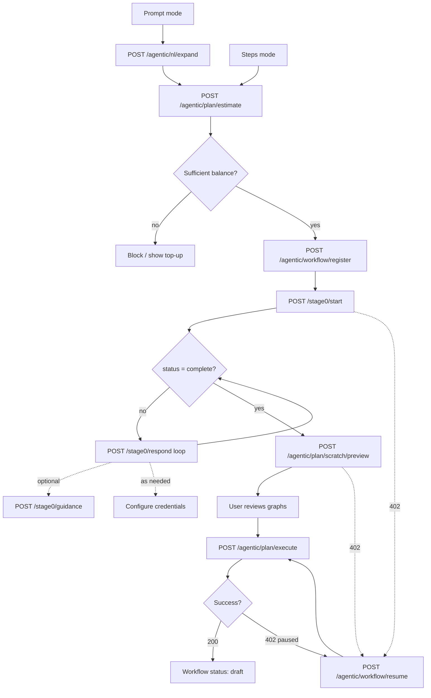

# Workflow Builder — End-to-End Flow Guide

**Audience:** Engineers onboarding to the workflow builder pipeline (backend, frontend, QA).

**Purpose:** High-level overview of what each step does, when it runs, and how the pieces connect.

**KT (files, functions, debugging):** [`docs/architecture-review/WORKFLOW_BUILDER_ARCHITECTURE.md`](architecture-review/WORKFLOW_BUILDER_ARCHITECTURE.md). Use that document when you need the call path inside the code. This file is the short narrative.

**Base path:** `{BASE}/aiqod-agent/agent` (e.g. `http://localhost:5010/dev/aiqod-agent/agent`)

---

## What the workflow builder does

The workflow builder turns a user's intent (natural-language prompt or structured phases/steps) into a runnable **LangGraph workflow** with:

- Per-phase workflow graphs (nodes, edges, validation)
- Generated UI screens (Angular) and backend tools where needed
- Persisted workflow config in MongoDB (`Process_Configs`)

The pipeline is intentionally split into phases so users can review cost, clarify requirements, preview graphs, and only then pay for heavy codegen.

---

## End-to-end flow (required order)

| Step | Endpoint | Billing | Mongo writes |
|------|----------|---------|--------------|
| 0. Expand (prompt mode only) | `POST /agentic/nl/expand` | LLM (not part of `predictedCost`) | None |
| 1. Preflight cost | `POST /agentic/plan/estimate` | None | None |
| 2. Admission | `POST /agentic/workflow/register` | Reserves subscriber hold | Creates `Process_Configs` |
| 3. Clarification | `POST /stage0/start` → `/stage0/respond` | LLM charges | Session in Redis (30 min TTL) |
| 4. Graph preview | `POST /agentic/plan/scratch/preview` | LLM charges | Updates `Process_Configs` |
| 5. Codegen | `POST /agentic/plan/execute` | LLM charges (long-running) | Persists graphs, code, `status: draft` |
| — Resume | `POST /agentic/workflow/resume` | Continues billing | Reads checkpoint |

**Stable identifier:** `projectId` === `workflowId` — one MongoDB document in `Process_Configs` for the entire build.

---

## Step-by-step overview

### 0. `POST /agentic/nl/expand` — Prompt mode only

**When:** The user typed one free-text prompt. Skip this entire step in steps mode.

**What happens:** `expand_prompt_to_enterprise_steps` turns the prompt into enterprise logical steps (`preferredKind` of `ui_screen` or `tool`). The UI shows them. Optional `POST /agentic/nl/steps/revise` if the user edits the list.

**Handoff:** Pass the latest steps as `expandedSteps` on estimate and on `/stage0/start`, together with the original `prompt`. Estimate returns 400 in prompt mode without `expandedSteps`.

---

### 1. `POST /agentic/plan/estimate` — Preflight cost

**When:** User submits a workflow idea (prompt or structured steps), before any billed work.

**What happens:**
- Heuristic cost math only — counts steps/phases, estimates tokens and USD for Stage 0, preview, and execute
- **No LLM calls**, **no Mongo writes**
- Optionally checks subscriber wallet and returns `sufficientBalance`

**Key outputs:**
- `predictedCost` — pass this to `/workflow/register` as the workflow budget cap
- `stage0CostUsd`, `previewCostUsd`, `executeCostUsd` — per-phase breakdown
- `sufficientBalance` — whether the subscriber can afford the full estimate

**Input:**

- Prompt mode: `{ prompt, expandedSteps }` from `/nl/expand` (or `/nl/steps/revise`)
- Steps mode: `{ steps }`

---

### 2. `POST /agentic/workflow/register` — Admission & billing record

**When:** Immediately after estimate, once per workflow build, before any LLM step.

**What happens:**
- Creates (or updates) a `Process_Configs` document for this workflow
- Sets `predictedCost` as the per-workflow budget cap
- With `reserveSubscriberCredits: true` (recommended for UI): increments `subscribers.AICredits.reserved` by `predictedCost`

**Why it exists:** Separates “show me the price” from “start charging me.” All subsequent billed endpoints charge against this cap and/or the subscriber wallet.

**Key outputs:** `projectId`, `predictedCost`, `reservedUsd`, `reservationStatus: "active"`

**Errors:** `402` if wallet can't cover the hold; `409` if already registered with a different `predictedCost`.

---

### 3. Stage 0 — Clarification & credentials (`/stage0/*`)

Stage 0 runs **before** graph planning. It ensures requirements are clear and credentials are accounted for.

#### `POST /stage0/start`

**What happens:**
1. **Credential check (0-A):** Reads configured secret *names* for the project (never values)
2. **First clarification turn (0-B):** LLM analyzes the prompt/steps and returns MCQ questions or completes immediately
3. Creates a Stage 0 session (`stage0_<id>`) with 30-minute TTL

**Requires:** `projectId` (must match registered workflow), plus `prompt` or `steps`.

**Status values:**
- `needs_input` — more MCQ answers required; show `questions[]`
- `complete` — requirements clear; `requirementSummary` is ready for preview

#### `POST /stage0/respond`

**What happens:** User submits MCQ answers. Backend refreshes credentials, updates session, returns more questions or `status: "complete"`.

**Loop:** Call repeatedly until `status === "complete"` (max ~10 turns).

#### `POST /stage0/guidance` (optional)

**What happens:** On-demand setup help for a specific requirement flag (e.g. “How do I configure SMTP?”). Returns markdown guidance.

**Does not** advance the QnA turn counter — safe to call while user is still answering questions.

#### Credentials (as needed)

If Stage 0 detects missing secrets, the user configures them via the credentials API for the project. Stage 0 re-checks on each `/respond` call.

**Key handoff for next step:** When complete, `requirementSummary.planner_handoff` is the primary context passed into preview via `stage0Handoff`.

---

### 4. `POST /agentic/plan/scratch/preview` — Build phase graphs

**When:** After Stage 0 completes (or can be skipped in flows that don't use Stage 0, though the recommended path includes it).

**What happens:**
1. Resolves logical steps from prompt (LLM analysis) or uses provided `steps`
2. Injects Stage 0 context (`stage0Handoff.requirementSummary.planner_handoff`) into the skeleton planner
3. Plans per-phase LangGraph structures (nodes, edges, `GENERATE:*` placeholders)
4. Validates graphs
5. Persists preview state to `Process_Configs` (`status: "preview"`)

**Billing:** LLM calls charged against workflow cap / wallet.

**Key outputs:**
- `phaseGraphs[]` — one graph per phase; user reviews on canvas
- `workflowId`, warnings, node counts
- These `phaseGraphs` must be passed **unchanged** to execute

**Note:** This is the **scratch** planner — it bypasses capability retrieval/matching and builds graphs from scratch.

---

### 5. `POST /agentic/plan/execute` — Gap resolution + codegen + persist

**When:** User confirms the previewed graphs.

**What happens (high level):**
1. **Gap resolution** — `GENERATE:ui_screen` → Angular codegen; `GENERATE:tool` → LLM tool generation + registry
2. **Post-gap re-validation** — graphs re-checked after real nodes replace placeholders
3. **Tool enrichment** — source/class_path metadata attached
4. **LangGraph code generation** — per-phase + combined runnable code
5. **Mongo persistence** — workflow saved with `status: "draft"`

**Billing:** Heavy LLM usage; can run for minutes. Charges tracked in `budgetSpentUsd` / `overflowSpentUsd`.

**Auto settlement on exit:** On successful completion, unused reservation is released automatically (`predictedCost - budgetSpentUsd` returned to available balance). On credit pause (402), the hold is **kept** so the build can resume.

**Input:** Must include the exact `phaseGraphs` from preview, plus `workflowId` / `projectId`.

---

### 6. `POST /agentic/workflow/resume` — Continue after budget exhaust

**When:** Any billed step returns **HTTP 402** (workflow cap or subscriber wallet exhausted mid-build).

**What happens:**
- Reads `workflow_build_checkpoints` for where the build stopped
- Re-runs from that checkpoint — same response shape as the original paused endpoint
- No need to resend `phaseGraphs` or Stage 0 answers

**Paused at → response type:**

| Checkpoint stage | Resume returns |
|------------------|----------------|
| `stage0` | `Stage0Response` |
| `preview` | `AgenticPlanPreviewResponse` |
| `execute` | `AgenticPlanResponse` |

**After top-up:** User recharges wallet, then calls `/workflow/resume` (not re-register).

---

## Billing model (simplified)

Two layers work together:

| Layer | Where | What it tracks |
|-------|-------|----------------|
| **Subscriber wallet** | `subscribers.AICredits` | `limit`, `used`, `reserved` (available = limit − used − reserved) |
| **Per-workflow cap** | `Process_Configs` | `predictedCost`, `budgetSpentUsd`, `overflowSpentUsd` |

**Register** reserves `predictedCost` on the wallet. Each LLM call increments `used` and decrements `reserved` while under cap. If the cap is exhausted but wallet still has funds, spend moves to `overflowSpentUsd` (wallet-only mode).

**Two pause scenarios (both return 402):**

| Scenario | Code | Meaning |
|----------|------|---------|
| Workflow cap used up | `WORKFLOW_BUDGET_EXHAUSTED` | `budgetSpentUsd >= predictedCost` |
| Wallet empty | `INSUFFICIENT_SUBSCRIBER_BALANCE` | No available balance left |

---

## Workflow statuses (in `Process_Configs`)

| Status | Meaning |
|--------|---------|
| `stage0_in_progress` | Clarification in progress |
| `preview` | Graphs built, awaiting user confirm + execute |
| `building` | Preview or execute actively running |
| `draft` | Build complete — runnable workflow |
| `paused_credit` | Stopped mid-build for billing; resumable |

Use `POST /agentic/workflow/progress` for authoritative pause/resume state and progress percent.

---

## Auxiliary endpoints

| Endpoint | Purpose |
|----------|---------|
| `POST /agentic/workflow/progress` | Where build stopped, % complete, billing strip, `canResume` |
| `POST /agentic/workflow/release` | Abandon build — release unused hold (does not refund spent) |
| `GET /stage0/session/{sessionId}` | Restore Stage 0 UI after page refresh |
| `GET /credits` | Read subscriber wallet for top-up UI |

---

## Input modes

| Mode | First call | What estimate / Stage 0 / preview receive |
|------|------------|-------------------------------------------|
| Prompt | `POST /agentic/nl/expand` | `prompt` plus `expandedSteps` (estimate and Stage 0). Preview receives `prompt` plus `stage0Handoff` |
| Steps | none | `steps` only. Do not call `/nl/expand` |

Exactly one of `prompt` or `steps` on Stage 0, estimate, and preview. Both set, or neither set, is `400`. Prompt-mode estimate also requires `expandedSteps`.

---

## Typical request identity

All billed endpoints need tenant context:

| Field | Body key | Header fallback |
|-------|----------|-----------------|
| Organization | `orgId` | `x-org-id` |
| Subscriber | `subscriberId` | `x-subscriber-id` |
| User | `userId` | `x-user-id` |

`projectId` from register must be reused on Stage 0, preview, and execute.

---

## Mental model for colleagues

0. **Expand** (prompt mode only) = “Turn this paragraph into steps I can edit”
1. **Estimate** = “What will this cost?” (free, fast)
2. **Register** = “I agree — hold my credits and open a workflow record”
3. **Stage 0** = “Let me clarify requirements and check credentials before we plan”
4. **Preview** = “Show me the workflow graphs before codegen”
5. **Execute** = “Generate everything and save a runnable workflow”
6. **Resume** = “I topped up — continue where we left off”

The split exists so users aren't charged for heavy codegen until they've seen the plan, and so mid-build credit exhaustion doesn't lose progress.

---

## Companion documentation

| Doc | Focus |
|-----|-------|
| `docs/architecture-review/WORKFLOW_BUILDER_ARCHITECTURE.md` | **KT:** files, main functions, what to open when debugging |
| `docs/prompt-builder/WORKFLOW_BUILDER_CREDIT_FLOW_README.md` | Credit/billing, 402 handling, frontend binding |
| `docs/WORKFLOW_BUILDER_CREDIT_RESUME_FRONTEND_GUIDE.md` | Pause/resume UI patterns |
| `docs/STAGE0_API_README.md` | Stage 0 API details, MCQ shapes, guidance |
| `docs/AGENTIC_WORKFLOW_FRONTEND_GUIDE.md` | Preview/execute request/response reference |
| `docs/prompt-builder/WORKFLOW_BUILDER_BACKEND_FRONTEND_README.md` | Full builder integration (canvas, runtime) |

**Backend source of truth:** `backend/agent_new.py`, `backend/stage0.py`, `backend/services/workflow_budget_service.py`
