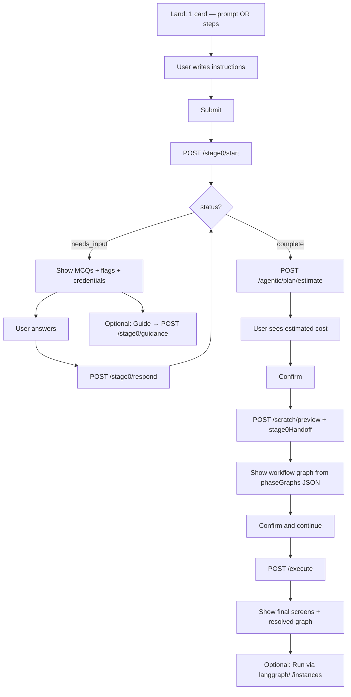
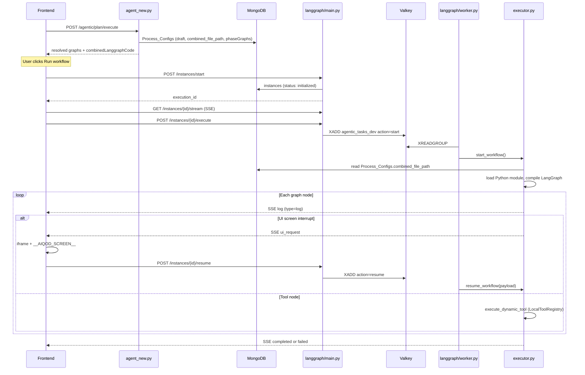
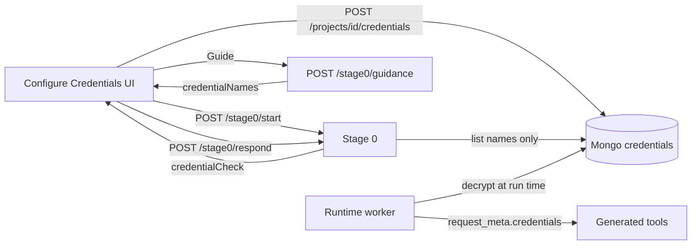

# Workflow Builder — Backend ↔ Frontend Integration

**Audience:** Frontend engineers implementing the workflow builder UI.

**Backend source of truth:** `backend/agent_new.py` (Pydantic models + route handlers).

This is the **only doc you need** to connect the frontend to the workflow builder APIs — from requirement clarification through graph preview, execute (`agent_new.py`), and running the workflow (`langgraph/`).

---

## Table of contents

1. [What you are building](#1-what-you-are-building)
   - [1.1 End-to-end UX flow (screen by screen)](#11-end-to-end-ux-flow-screen-by-screen)
2. [Connect frontend to backend](#2-connect-frontend-to-backend)
3. [Shared types](#3-shared-types)
4. [Stage 0 — requirement clarification](#4-stage-0--requirement-clarification)
5. [Agentic plan — estimate, preview, execute](#5-agentic-plan--estimate-preview-execute)
   - [5.4 List created workflows (My workflows)](#54-list-created-workflows-my-workflows)
6. [Graph canvas rendering](#6-graph-canvas-rendering)
   - [6.1 Frontend data binding (nodes, screens, tools)](#61-frontend-data-binding-nodes-screens-tools)
7. [Credits: USD vs product credits](#7-credits-usd-vs-product-credits)
8. [Complete client flow](#8-complete-client-flow)
9. [UI patterns and state](#9-ui-patterns-and-state)
10. [After execute — running the workflow (`langgraph/`)](#10-after-execute--running-the-workflow-langgraph)
11. [Error handling](#11-error-handling)
12. [curl smoke tests](#12-curl-smoke-tests)
13. [Integration checklist](#13-integration-checklist)
14. [Configure credentials (project secrets)](#14-configure-credentials-project-secrets)

---

## 1. What you are building

The workflow builder turns user intent into a **multi-phase LangGraph workflow** with generated UI screens and tools.

**Stage 0 has two separate concerns:**

| Concern | Endpoints | Purpose |
|---------|-----------|---------|
| **QnA** | `start`, `respond`, `session` | Multi-turn MCQ clarification until the LLM is satisfied |
| **Guidance** | `guidance` | On-demand setup help — does **not** advance QnA |

**Scratch planner:** `/scratch/preview` uses the scratch graph planner (no capability catalog matching). The response shape matches the standard preview API so **`/execute` is unchanged**.

**Two phases for the frontend:**

| Phase | What the user sees | Ends when |
|-------|-------------------|-----------|
| **Build (design-time)** | Input → MCQ → cost → graph preview → generated screens + graph | `/execute` completes |
| **Run (runtime)** | Live workflow execution with SSE + UI interrupts | Optional — see [§10](#10-after-execute--running-the-workflow-langgraph) |

The primary product flow documented below is **Build**. Running the workflow is a separate step after build.

---

### 1.1 End-to-end UX flow (screen by screen)

This is the intended user journey and the API call at each step.

#### Screen 0 — My workflows (already created)

Before starting a new build, the user can open **My workflows**:

1. Call **`POST /agentic/workflows/list`** with `orgId`, `subscriberId`, optional `status: "draft"`.
2. Render a table/cards from `workflows[]`.
3. **Run** (if `status === "draft"`) → [Screen 8](#screen-8--run-workflow-optional) via `langgraph/`.
4. **Create new** → [Screen 1](#screen-1--landing--input).

#### Screen 1 — Landing / input

User lands on the website and sees **one card with two options**:

| Option | UI | API field |
|--------|-----|-----------|
| **Write one prompt** | Single textarea | `prompt: "…"`, `steps: null` |
| **Write step-by-step instructions** | Phase / step builder | `steps: [...]`, `prompt: null` |

User writes their instructions. Nothing is sent to the backend yet.

#### Screen 2 — Submit → Stage 0 clarification

User clicks **Submit** → call **`POST /stage0/start`**.

The backend:
- Analyses the user's instructions
- Checks which secrets are already configured for `projectId`
- Finds missing details or missing configured secrets
- Returns MCQ questions (`status: "needs_input"`) or completes immediately (`status: "complete"`)

Show:
- Assistant `message`
- MCQ `questions` (radio / select per question)
- `credentialCheck` — configured secret **names** only (never values)
- `detectedFlags` — gaps with severity (CRITICAL vs WARN)
- **Guide** button per flag → **`POST /stage0/guidance`** (does not advance QnA)

#### Screen 3 — MCQ loop (`/stage0/respond`)

User answers the questions and clicks **Submit answers** → call **`POST /stage0/respond`**.

**Important:** this is a **per-turn loop**, not a single bulk submit on the first call.

```
/start → show questions → /respond (one round of answers)
       → more questions? → /respond again → … → status === "complete"
```

- Each `/respond` sends **one round** of answers in the `answer` field.
- You **may** combine answers to all visible MCQs into one `answer` string for that turn.
- You **may not** skip `/respond` and expect `/start` alone to finish clarification.
- The loop continues until the LLM is satisfied (`status: "complete"`) or **10 turns** max.
- If the backend still needs something, it returns new `questions` and the user answers again.
- **Edge case:** if `/start` already returns `status: "complete"` (no MCQs needed), skip the respond loop and go straight to the cost estimate screen.

**Guide (any time during MCQ):** user clicks **Guide** on a flag → **`POST /stage0/guidance`** → show `guidanceMarkdown` (how to obtain and configure secrets). This is side-channel help only — user must still call `/respond` to advance QnA.

**Page refresh:** if `stage0SessionId` is in `localStorage` → **`GET /stage0/session/{sessionId}`** to restore conversation, flags, and credential state (30-minute TTL).

#### Screen 4 — Cost estimate

After Stage 0 completes (`status: "complete"`), call **`POST /agentic/plan/estimate`** with the **same** `prompt` or `steps` the user submitted.

Show the user:
- `totalCostUsd` — rough heuristic cost (label as **estimate**, not final billing)
- `stepCount`, `uiScreenCount`, `toolCount` — optional breakdown

User reviews the estimated cost and clicks **Confirm**.

> **Recommended order:** estimate **after** Stage 0 (requirements are clearer). Do not call `/scratch/preview` until the user confirms the estimate screen.

#### Screen 5 — Graph preview

User clicks **Confirm** on the cost screen → call **`POST /agentic/plan/scratch/preview`**.

**Required on this call (easy to miss):**

| Field | Value |
|-------|--------|
| Same `prompt` or `steps` | As submitted at start |
| `stage0Handoff` | `{ requirementSummary }` — copy the **full object** from the final Stage 0 response (**required** when Stage 0 ran) |
| `minimumCredits` | Integer **> 0** (your product minimum for credit preflight) |
| `subscriberId` | **Required** |

The backend generates the **agentic graph definition** (`phaseGraphs` — nodes, edges, `GENERATE:*` placeholders).

Show the user a **workflow graph** on the frontend. The API returns **structured JSON** (`nodes` / `edges`), **not** Mermaid text. Convert on the frontend to:
- React Flow / XYFlow canvas (recommended)
- Mermaid (generate from JSON)
- D3 / Cytoscape / custom SVG

Nodes with `capabilityRef.capabilityId` starting with **`GENERATE:`** are placeholders — show them visually distinct (dashed border, “will be generated” label).

User reviews the graph and clicks **Confirm and continue**.

#### Screen 6 — Execute (generation)

User clicks **Confirm and continue** → call **`POST /agentic/plan/execute`**.

Pass back **verbatim** from preview:
- `workflowId`
- `phaseGraphs` (unchanged)
- tenant ids, `mode`, `steps`, `estimatedCredits` / `minimumCredits`

The backend generates:
- Real **tools** for nodes whose `capabilityRef.capabilityId` was `GENERATE:*` with `config.generation.kind === "tool"`
- Real **UI screens** (Angular bundles) for `GENERATE:*` nodes with `config.generation.kind === "ui_screen"`
- **LangGraph Python code** per phase

(`GENERATE:` ids look like `GENERATE:WelcomeForm` — the kind is in `node.config.generation.kind`, not in the id string.)

**Duration:** depends on node count and complexity. Simple workflows: a few minutes. Complex workflows with many screens/tools: **30–60+ minutes** is possible. Show a persistent loading state, disable double-submit, and consider per-phase progress if you poll or stream logs.

#### Screen 7 — Build complete (final result)

When `/execute` returns successfully, show the user a **read-only summary** of the built workflow. This is **design-time display** — nothing runs until the user clicks **Run workflow** (Screen 8).

**Persist in app state (required for Screen 8):**

| State key | Source | Why |
|-----------|--------|-----|
| `workflowId` | **`preview.workflowId`** (execute response does **not** include it) | Passed to `POST /instances/start` as `workflow_id` |
| `projectId` | `preview.projectId` or `planInput.projectId` | Screen URL lookup (`GET /ui-screen/{screen_id}?project_id=…`) |
| `phaseGraphs` | `result.phaseGraphs` | Canvas + node detail panel |
| `executeResult` | full `AgenticPlanResponse` | Warnings, optional `combinedLanggraphCode` |

**Gap success check before enabling Run:**

```typescript
function hasUnresolvedGaps(phaseGraphs: PhaseGraphResult[]): boolean {
  return phaseGraphs.some(p =>
    p.graph.nodes.some(n => n.capabilityRef?.capabilityId?.startsWith("GENERATE:"))
  );
}
// Enable "Run workflow" only when !hasUnresolvedGaps(result.phaseGraphs)
```

| What to show | Source | Binding notes |
|--------------|--------|---------------|
| **Workflow graph canvas** | `result.phaseGraphs` | Re-render nodes/edges; all `GENERATE:*` should be resolved to `ui:*` / `tool:*` |
| **Node detail panel** (on node click) | Selected `GraphNode` — see [§6.1](#61-frontend-data-binding-nodes-screens-tools) | Name, spec/prompt, IO, capability |
| **Screens list** | `extractUiScreens(result.phaseGraphs)` + `GET /ui-screen/{screen_id}` | Show `screen_name`, `angular.public_url` for preview link |
| **Tools list** | `extractTools(result.phaseGraphs)` | Show tool name, `capabilityId`, IO from `declaredOutputs` |
| **Warnings** | `result.warnings` | Non-blocking; show inline |
| **LangGraph code** (optional) | `result.combinedLanggraphCode` | Debug / advanced users |

**Re-opening a built workflow later:** `GET /configdetails` with header `workflow-id: {workflowId}` returns the full `Process_Configs` document including `agentic_process.phaseGraphs` — use the same binding rules as above.

The workflow is now **built** (`Process_Configs` status `"draft"`). The user can optionally **run** it via the **`langgraph/`** runtime service — see [§10](#10-after-execute--running-the-workflow-langgraph).

---

#### Full flow diagram



#### API call summary

| Step | User action | Endpoint |
|------|-------------|----------|
| 0 | View existing workflows | `POST /agentic/workflows/list` |
| 1 | Choose prompt or steps, write instructions | — |
| 2 | Submit | `POST /stage0/start` |
| 3 | Answer MCQs (loop) | `POST /stage0/respond` |
| — | Click Guide | `POST /stage0/guidance` |
| — | Page refresh | `GET /stage0/session/{sessionId}` |
| 4 | Stage 0 complete → show cost | `POST /agentic/plan/estimate` |
| 5 | Confirm cost → show graph | `POST /agentic/plan/scratch/preview` |
| 6 | Confirm graph → generate assets | `POST /agentic/plan/execute` |
| 7 | Show final screens + graph | — (render execute response) |
| 8 | Optional: **Run workflow** | `langgraph/` → `POST /instances/start` → SSE → `/execute` → `/resume` on UI nodes |

#### Screen 8 — Run workflow (optional)

After build completes (Screen 7), the user may click **Run workflow**. This starts a **live instance** — the worker runs the compiled Python graph (`combined_file_path`), not the JSON canvas.

**What the frontend does vs what the worker does:**

| Node type | At runtime | Frontend responsibility |
|-----------|------------|-------------------------|
| `tool` | Worker calls `execute_dynamic_tool` | Show progress via SSE `log` only — **no direct FE call** |
| `ui` / `ui_screen` | Graph pauses with `interrupt` | On SSE `ui_request`: load iframe, collect output, `POST /resume` |
| `router` / `agent` | Worker executes automatically | Show SSE `log` |

**Run flow:**

1. **Global inputs form** — read `graph.requiredGlobalInputs` from each phase (e.g. `["city","userId"]`). Build `initial_state` object keyed by those names (strip `{{global.X}}` → `X`).
2. `POST {EXEC_ROOT}/instances/start` with:
   - `workflow_id`: **`workflowId` from preview** (kept in app state — execute response has no `workflowId`)
   - `initial_state`: the global inputs form values
3. Open SSE: `GET {EXEC_ROOT}/instances/{execution_id}/stream` **before** calling execute.
4. `POST {EXEC_ROOT}/instances/{execution_id}/execute` — worker loads `combined_file_path` and runs the LangGraph.
5. On SSE `log`: append to execution timeline (`node_name`, `outputs`, `completed_at`).
6. On SSE `ui_request`: `mountScreenAndWait(screen_id, ui_data)` → `POST …/resume` with `{ payload: screenOutput }`.
7. On SSE `completed` / `failed`: close stream, update UI.

See [§6.1](#61-frontend-data-binding-nodes-screens-tools) for screen URL resolution and [§10](#10-after-execute--running-the-workflow-langgraph) for full runtime details.

---

## 2. Connect frontend to backend

### 2.1 Run the backend locally

From `backend/`:

```bash
uvicorn agent_new:app --reload --host 0.0.0.0 --port 5010
```

Routes are mounted with an API prefix (default **`/dev`** from `config.json` → `api_prefix`).

| Environment | Example base |
|-------------|--------------|
| Local | `http://localhost:5010/dev` |
| Staging / prod | `https://<host>/<api_prefix>` |

**Full path pattern:**

```text
{BASE_URL}/aiqod-agent/agent/<endpoint>
```

**All workflow-builder endpoints:**

```text
POST {BASE}/aiqod-agent/agent/stage0/start
POST {BASE}/aiqod-agent/agent/stage0/respond
POST {BASE}/aiqod-agent/agent/stage0/guidance
GET  {BASE}/aiqod-agent/agent/stage0/session/{sessionId}

POST {BASE}/aiqod-agent/agent/agentic/plan/estimate
POST {BASE}/aiqod-agent/agent/agentic/plan/scratch/preview
POST {BASE}/aiqod-agent/agent/agentic/plan/execute
POST {BASE}/aiqod-agent/agent/agentic/workflows/list
GET  {BASE}/aiqod-agent/agent/agentic/workflows/{workflowId}
GET  {BASE}/aiqod-agent/agent/configdetails          # header: workflow-id
GET  {BASE}/aiqod-agent/agent/ui-screen/{screen_id}  # ?project_id= — screen bundle URL
GET  {BASE}/aiqod-agent/agent/ui-list                # all screens (optional)

POST {BASE}/aiqod-agent/agent/projects/{projectId}/credentials
GET  {BASE}/aiqod-agent/agent/projects/{projectId}/credentials
DELETE {BASE}/aiqod-agent/agent/projects/{projectId}/credentials/{name}
```

**Runtime endpoints (`langgraph/`, after build):**

```text
POST {EXEC_ROOT}/instances/start
POST {EXEC_ROOT}/instances/{execution_id}/execute
POST {EXEC_ROOT}/instances/{execution_id}/resume
GET  {EXEC_ROOT}/instances/{execution_id}/stream
POST {EXEC_ROOT}/instances/list-by-org-sub
```

Example:

```text
POST http://localhost:5010/dev/aiqod-agent/agent/stage0/start
```

### 2.2 Frontend environment variables

```bash
# .env.local (Vite example)
VITE_AGENT_API_BASE=http://localhost:5010/dev
VITE_AGENT_API_PREFIX=/aiqod-agent/agent
VITE_EXEC_API_BASE=http://localhost:8011/dev   # must match langgraph/.env APP_PORT
VITE_SCREEN_CDN_BASE=https://liberty-fs.example.com:843
```

```typescript
const AGENT_ROOT = `${import.meta.env.VITE_AGENT_API_BASE}${import.meta.env.VITE_AGENT_API_PREFIX}`;
const EXEC_ROOT = import.meta.env.VITE_EXEC_API_BASE;  // langgraph runtime
```

### 2.3 Headers (all agent endpoints)

| Header | Purpose |
|--------|---------|
| `Content-Type` | `application/json` |
| `Authorization` | Bearer token (if required by gateway) |
| `x-org-id` | Organization ID (optional if sent in body) |
| `x-subscriber-id` | Subscriber ID — **required** for credit checks on preview/execute |
| `x-user-id` | User ID (optional) |

Body fields **override** headers when both are present.

### 2.4 Tenant fields

| Field | When to send |
|-------|--------------|
| `projectId` | **Required** for Stage 0 (credential lookup). Use your screen/workflow project MongoDB id. |
| `orgId` | Always (body or header) |
| `subscriberId` | **Required** for `scratch/preview` and `execute` |
| `userId` | Recommended |
| `selectedName` | Workflow display name |
| `selectedType`, `selectedCategory`, `token` | Optional metadata persisted with the workflow |

### 2.5 API client

```typescript
type TenantContext = {
  projectId: string;
  orgId: string;
  subscriberId: string;
  userId: string;
  token?: string;
};

async function agentPost<T>(path: string, body: unknown, tenant?: TenantContext): Promise<T> {
  const res = await fetch(`${AGENT_ROOT}${path}`, {
    method: "POST",
    headers: {
      "Content-Type": "application/json",
      ...(tenant?.orgId && { "x-org-id": tenant.orgId }),
      ...(tenant?.subscriberId && { "x-subscriber-id": tenant.subscriberId }),
      ...(tenant?.userId && { "x-user-id": tenant.userId }),
    },
    body: JSON.stringify(body),
  });

  if (!res.ok) {
    const detail = await res.json().catch(() => ({ message: res.statusText }));
    throw Object.assign(new Error(`API ${res.status}`), { status: res.status, detail });
  }
  return res.json();
}

async function agentGet<T>(path: string): Promise<T> {
  const res = await fetch(`${AGENT_ROOT}${path}`);
  if (!res.ok) {
    const detail = await res.json().catch(() => ({ message: res.statusText }));
    throw Object.assign(new Error(`API ${res.status}`), { status: res.status, detail });
  }
  return res.json();
}
```

---

## 3. Shared types

### 3.1 `AgenticPlanRequest`

Used by **`/stage0/start`**, **`/agentic/plan/estimate`**, and **`/agentic/plan/scratch/preview`**.

**Validation:** exactly **one** of `prompt` (non-empty string) **or** `steps` (non-empty array). Both or neither → **400**.

Build this object **once** when the user submits their workflow. Reuse it through Stage 0 → preview → execute.

```typescript
type PhaseType = "FREEZE" | "DYNAMIC";

interface AgenticSubStep {
  stepId: string;
  name: string;
  description: string;
  preferredKind?: "ui_screen" | "tool" | null;
}

interface AgenticPhaseStep {
  stepId: string;
  name: string;
  description: string;
  subSteps?: AgenticSubStep[] | null;
  phaseType?: PhaseType; // default "FREEZE"
}

interface AgenticPlanRequest {
  projectId?: string | null;
  orgId?: string | null;
  subscriberId?: string | null;
  userId?: string | null;
  prompt?: string | null;
  steps?: AgenticPhaseStep[] | null;
  selectedName?: string | null;
  selectedType?: string | null;
  selectedCategory?: string | null;
  token?: string | null;
  minimumCredits?: number | null;       // scratch/preview only — must be > 0
  stage0Handoff?: { requirementSummary: RequirementSummary };  // scratch/preview only
}
```

**Input modes:**

| Mode | UI | Request |
|------|-----|---------|
| **Prompt** | Single textarea / chat brief | `prompt: "…"`, `steps: null` |
| **Steps** | Phase builder (phases + sub-steps) | `steps: [...]`, `prompt: null` |

- **`phaseType`:** `FREEZE` = deterministic graph (default); `DYNAMIC` = ReAct agent loop for that phase.
- **`preferredKind`** on sub-steps (optional): force one `ui_screen` or `tool` node per step in scratch planning.
- **`minimumCredits`:** only for `scratch/preview`, not Stage 0.

**Example — steps mode:**

```json
{
  "projectId": "test18_sb_5beaabd82ac6767c86dc316c",
  "orgId": "5c495dbfffa2a85b2c19a77f",
  "subscriberId": "5beaabd82ac6767c86dc316c",
  "userId": "5beaabd82ac6767c86dc313e",
  "selectedName": "Weather Email Workflow",
  "steps": [
    {
      "stepId": "phase_1",
      "name": "Weather pipeline",
      "description": "Fetch weather, summarise, save, email",
      "phaseType": "FREEZE",
      "subSteps": [
        { "stepId": "L1", "name": "Get city input", "description": "Collect city name from the user" },
        { "stepId": "L2", "name": "Fetch and summarise weather", "description": "Call weather API and use Gemini to summarise" },
        { "stepId": "L3", "name": "Save and email", "description": "Save to weather_logs and send email" }
      ]
    }
  ]
}
```

**Example — prompt mode:**

```json
{
  "projectId": "test18_sb_5beaabd82ac6767c86dc316c",
  "orgId": "5c495dbfffa2a85b2c19a77f",
  "subscriberId": "5beaabd82ac6767c86dc316c",
  "userId": "5beaabd82ac6767c86dc313e",
  "selectedName": "My Workflow",
  "prompt": "Build a workflow that fetches weather, summarises with Gemini, saves to weather_logs, and emails the user."
}
```

### 3.2 Stage 0 types

```typescript
interface MCQQuestion {
  question_text: string;
  options: string[];       // last option is usually "Other / I'll type my own answer"
  flag_type: string;       // links to detectedFlags[].flag_type
  severity: "CRITICAL" | "WARN";
}

interface RequirementFlag {
  flag_type: string;       // use as flagKey for /guidance
  description: string;
  severity: "CRITICAL" | "WARN";
  resolved: boolean;
  resolved_value: string | null;
}

interface CredentialCheck {
  workflow_id: string;
  configured_secret_names: string[];  // e.g. ["GEMINI_API_KEY", "EMAIL_SENDER"]
  has_any_secrets: boolean;
}

interface LogicalStep {
  stepId: string;
  name: string;
  description: string;
  inputs: string[];
  outputs: string[];
  preferredKind?: "ui_screen" | "tool" | "agent" | null;
}

interface RequirementSummary {
  phase_name: string;
  phase_goal: string;
  logical_steps: { step_number: number; description: string }[];
  steps: LogicalStep[];              // original steps when mode was "steps"
  llm_providers: string[];
  integrations: string[];
  db_schemas: Record<string, unknown>[];
  required_secrets: string[];
  already_configured: string[];
  config_guidance: [];             // always [] on complete — use /guidance per flag
  unresolved_warns: string[];
  planner_handoff: string;         // primary scratch-planner context — do NOT build on FE
}

interface Stage0Response {
  sessionId: string;
  status: "needs_input" | "complete";
  workflowId: string;
  workflowName: string | null;
  mode: "prompt" | "steps";
  analysis_source: "llm" | "fallback" | null;
  message: string | null;
  questions: MCQQuestion[];
  credentialCheck: CredentialCheck | null;
  detectedFlags: RequirementFlag[];
  resolvedFlags: RequirementFlag[];
  turnCount: number;
  requirementSummary: RequirementSummary | null;
  warnings: string[];
}
```

**Example `planner_handoff` text** (server-generated, illustrative):

```text
STAGE 0 CLARIFIED REQUIREMENTS (authoritative — do not contradict):
LLM: google_gemini / gemini-3.5-flash-lite (secret: GEMINI_API_KEY)
External API: openweathermap — weather_by_city
Email: SMTP gmail (EMAIL_SENDER, EMAIL_PASSWORD)
DB `weather_logs`: city:string, temperature:number, summary:string, created_at:datetime
Workflow steps:
  - Fetch weather from OpenWeatherMap for input city
  - Summarize with gemini-3.5-flash-lite
  - Insert row into weather_logs
  - Send email via configured SMTP
```

### 3.3 Graph / preview types

```typescript
interface PhaseGraphResult {
  graph: GraphDefinition;
  validation_warnings: string[];
  binding_fixes_applied: number;
  gap_generations: string[];
  langgraph_code: string;        // usually "" from preview
  phaseType: "FREEZE" | "DYNAMIC";
}

interface GraphDefinition {
  graphId: string;
  phaseId: string;
  phaseName: string;
  name: string;
  description: string;
  goal: string;
  nodes: GraphNode[];
  edges: GraphEdge[];
  entryNodeId: string;
  endNodeId: string;
  requiredGlobalInputs: string[];
}

interface GraphNode {
  nodeId: string;
  type: string;  // "tool" | "ui" | "ui_screen" | "agent" | "router" | "fallback_router" | "end"
  name: string;
  stepId?: string | null;
  capabilityRef?: {
    capabilityId: string;  // "GENERATE:WelcomeForm" | "tool:..." | "ui:..."
    kind: string;          // "tool" | "ui_screen" | "agent"
  } | null;
  config: {
    inputBindings: Record<string, string>;   // e.g. { "city": "{{global.city}}", "email": "{{collect_user_info.email}}" }
    declaredOutputs: { name: string; dataType?: string; required?: boolean; description?: string }[];
    generation?: {
      kind: string;        // "ui_screen" | "tool" — present on preview; **null after execute**
      description: string;
      inputs: { name: string; dataType?: string; required?: boolean; description?: string }[];
      outputs: { name: string; dataType?: string; required?: boolean; description?: string }[];
    } | null;
    generationDescription?: string | null;  // **post-execute prompt/spec** — use this for "prompt used" display
    stateReads?: string[];
    stateWrites?: string[];
  };
}

interface GraphEdge {
  fromNode: string;
  to: string;
  kind: string;              // "sequential" | "conditional" | "fallback"
  condition?: string | null;
}

interface AgenticPlanPreviewResponse {
  workflowId: string;
  workflowName: string | null;
  steps: LogicalStep[];
  mode: "prompt" | "steps";
  analysis_source: "llm" | "fallback" | null;
  warnings: string[];
  stepCapabilities: unknown[];     // always [] for scratch preview
  phaseGraphs: PhaseGraphResult[];
  estimatedCredits: number;        // 0 for scratch preview
  estimatedCreditsBreakdown: unknown[];
  generateNodeCount: number;
  uiScreenNodeCount: number;
  toolNodeCount: number;
}

interface AgenticPlanResponse {
  workflowName: string | null;
  steps: LogicalStep[];
  mode: "prompt" | "steps";
  analysis_source: "llm" | "fallback" | null;
  warnings: string[];
  stepCapabilities: unknown[];
  phaseGraphs: PhaseGraphResult[];  // after gap resolution
  combinedLanggraphCode: string;
  // NOTE: no workflowId — keep preview.workflowId in app state for /instances/start
}
```

---

## 4. Stage 0 — requirement clarification

Stage 0 runs **before** `scratch/preview`. It checks project credentials, asks **critical** clarification questions (MCQ), and produces a **requirement summary** with structured LLM/API/email/DB choices plus **`planner_handoff`** for the scratch skeleton planner.

### Session lifetime

| Setting | Value |
|---------|--------|
| Storage | MongoDB collection `stage0_sessions` |
| TTL | **30 minutes** from `createdAt` |
| After QnA complete | Session **kept** (not deleted) so `/guidance` still works |

**Persist in browser:**

```typescript
localStorage.setItem("stage0SessionId", response.sessionId);
```

- Keep `sessionId` until Stage 0 finishes **or** 30 minutes pass.
- On app load, if `stage0SessionId` exists → call `GET /stage0/session/{id}`.
- After `status === "complete"`, you can still call `/guidance` until TTL.

---

### 4.1 `POST /stage0/start`

**What it does:**

1. **Sub-phase 0-A — Credential check:** Reads secrets configured for `projectId`.
2. **Sub-phase 0-B — First clarification turn:** LLM analyzes the workflow and returns MCQ questions.
3. Creates a server session (30-minute TTL).

**Request:** `AgenticPlanRequest` — `projectId` is **required**. Do **not** send `minimumCredits`.

**Response:** `Stage0Response`

| `status` | Frontend action |
|----------|-----------------|
| `needs_input` | Show `message` + render `questions` as MCQs; enable “How to set up?” per flag |
| `complete` | No MCQs left; proceed to **cost estimate** (`/estimate`), then preview |

**Example response (`needs_input`):**

```json
{
  "sessionId": "stage0_1e373ce71dd2",
  "status": "needs_input",
  "workflowId": "test18_sb_5beaabd82ac6767c86dc316c",
  "workflowName": "Weather Email Workflow",
  "mode": "steps",
  "message": "I need some clarifications to set up your AI workflow...",
  "questions": [
    {
      "question_text": "Which weather API should be used?",
      "options": ["OpenWeatherMap", "AccuWeather", "WeatherAPI.com", "Other / I'll type my own answer"],
      "flag_type": "EXTERNAL_API",
      "severity": "CRITICAL"
    }
  ],
  "credentialCheck": {
    "workflow_id": "test18_sb_5beaabd82ac6767c86dc316c",
    "configured_secret_names": [],
    "has_any_secrets": false
  },
  "turnCount": 1,
  "requirementSummary": null,
  "warnings": []
}
```

**Frontend handling:**

1. Show `message` + MCQ form (one submit can combine all answers into one `answer` string).
2. Show **Configure Credentials** UI using `credentialCheck` — secrets added mid-flow are picked up on next `/respond`.
3. Persist `sessionId`.

| HTTP | Cause |
|------|-------|
| 400 | Both/neither `prompt` and `steps`, or missing `projectId` |
| 502 | LLM failure (session deleted on start failure) |
| 503 | Gemini API key unavailable |

---

### 4.2 `POST /stage0/respond`

**What it does:**

- Continues QnA with the user's answer for **this turn**.
- **Re-reads Configure Credentials** from DB before each turn (new secrets can clear credential questions).
- Returns more questions or `status: "complete"` with `requirementSummary`.
- Does **not** return setup guidance — use `/guidance` for that.

**Per-turn loop (not one bulk submit):**

Each call to `/respond` advances **one QnA turn**. The typical frontend pattern:

1. Show all MCQs from the current response.
2. User fills them in and clicks Submit.
3. Send **one** `/respond` with combined answers for that turn.
4. If `status === "needs_input"`, show the **new** questions and repeat.
5. Stop when `status === "complete"`.

You cannot skip the loop by sending all answers only on the first `/respond` unless the backend returns `complete` after that single turn — usually it takes multiple rounds until the LLM is satisfied (max **10 turns**).

**Request:**

```typescript
interface Stage0RespondRequest {
  sessionId: string;
  answer: string;           // MCQ selection and/or free text
  skipRemaining?: boolean;  // defer WARN-level flags and try to complete early
}
```

**Example:**

```json
{
  "sessionId": "stage0_ca048fcc11c2",
  "answer": "OpenWeatherMap for weather. weather_logs: city (string), temperature (number), summary (string), created_at (datetime). I configured GEMINI_KEY and EMAIL_SENDER / EMAIL_PASSWORD in Configure Secrets."
}
```

```typescript
while (stage0.status === "needs_input") {
  const answer = await ui.collectAnswers(stage0.questions, stage0.message);
  stage0 = await agentPost<Stage0Response>("/stage0/respond", {
    sessionId: stage0.sessionId,
    answer,
  }, tenant);
}
// stage0.status === "complete" → stage0.requirementSummary is set
```

| HTTP | Cause |
|------|-------|
| 400 | Empty `answer`, QnA already complete (`session_qna_complete`), turn count ≥ 10 |
| 404 | Session expired |
| 502 | LLM failure |

---

### 4.3 `POST /stage0/guidance`

**What it does:** Returns setup instructions for **one** requirement flag.

| Property | Value |
|----------|--------|
| Advances QnA? | **No** (`turnCount` unchanged) |
| Mutates flags? | **No** |
| Works after QnA complete? | **Yes** (same `sessionId`, until 30 min TTL) |
| Refreshes credentials? | **Yes** (read-only DB check) |

**When:** User clicks **“How do I set this up?”** on a flag card. Use `flagKey` = `detectedFlags[i].flag_type`.

**Request:**

```typescript
interface Stage0GuidanceRequest {
  sessionId: string;
  flagKey: string;              // e.g. "EMAIL_SENDER_CREDENTIALS"
  userQuestion?: string | null;  // e.g. "How do I create a Gmail app password?"
}
```

**Response:**

```typescript
interface Stage0GuidanceResponse {
  sessionId: string;
  flagKey: string;
  guidanceMarkdown: string;     // render as Markdown in modal / side panel
  docLinks: string[];
  credentialNames: string[];    // secret names to add in Configure Credentials
  source: "template" | "llm";
  dependencyType: string;
}
```

| HTTP | Cause |
|------|-------|
| 404 | Unknown session or unknown `flagKey` |
| 502 | LLM failure |
| 503 | Gemini key unavailable |

---

### 4.4 `GET /stage0/session/{sessionId}`

**What it does:** Restores session state after page refresh. Refreshes credential names from DB.

**Response:**

```typescript
interface Stage0SessionState {
  sessionId: string;
  status: "needs_input" | "complete";  // "expired" is in the schema but never returned — expired sessions → HTTP 404
  workflowId: string;
  workflowName: string | null;
  mode: "prompt" | "steps";
  turnCount: number;
  credentialCheck: CredentialCheck | null;
  detectedFlags: RequirementFlag[];
  resolvedFlags: RequirementFlag[];
  pendingQuestions: MCQQuestion[];  // may be empty — see note below
  conversationHistory: { role: "user" | "assistant"; content: string }[];
  requirementSummary: RequirementSummary | null;
  warnings: string[];
}
```

**Note on `pendingQuestions`:** The server does not persist the last MCQ list separately. After recovery via `GET /session`, you get `conversationHistory` and `detectedFlags` but often empty `pendingQuestions`. Keep the last `/start` or `/respond` response in memory (or `sessionStorage`) if you need to re-render the exact MCQ form without another API call.

On **404**, clear stored `sessionId` and prompt the user to start over.

---

### 4.5 Stage 0 → scratch preview handoff

After `status === "complete"`, call scratch preview with the **same** `projectId`, `orgId`, `steps` or `prompt`, and attach the full summary:

| Field in handoff | Used by planner? |
|------------------|------------------|
| `requirementSummary.planner_handoff` | **Yes** — primary context |
| `requirementSummary.logical_steps` | Fallback only if `planner_handoff` is empty |
| `integrations`, `db_schemas`, etc. | **No** — UI / credentials only |
| Top-level `steps` | **Yes** — graph structure (send same steps as at start) |

**Copy the entire `requirementSummary` from `/respond`** — do not hand-build `planner_handoff` on the frontend.

```typescript
function buildScratchPreviewPayload(
  planInput: AgenticPlanRequest,
  stage0: Stage0Response,
  minimumCredits: number,
): AgenticPlanRequest {
  if (stage0.status !== "complete" || !stage0.requirementSummary) {
    throw new Error("Stage 0 must be complete before scratch preview");
  }
  const summary = stage0.requirementSummary;
  return {
    ...planInput,
    minimumCredits,
    steps: planInput.steps?.length ? planInput.steps : summary.steps,
    stage0Handoff: { requirementSummary: summary },
  };
}
```

**Example scratch preview payload (abbreviated):**

```json
{
  "projectId": "test21_sb_5beaabd82ac6767c86dc316c",
  "orgId": "5c495dbfffa2a85b2c19a77f",
  "subscriberId": "5beaabd82ac6767c86dc316c",
  "userId": "5beaabd82ac6767c86dc313e",
  "minimumCredits": 100,
  "steps": [
    {
      "stepId": "phase_1",
      "name": "Weather pipeline",
      "description": "Fetch, summarise, save, email",
      "phaseType": "FREEZE",
      "subSteps": [
        { "stepId": "L1", "name": "Get city input", "description": "Collect city name" },
        { "stepId": "L2", "name": "Fetch weather", "description": "OpenWeatherMap + Gemini summary" },
        { "stepId": "L3", "name": "Save and email", "description": "weather_logs + SMTP" }
      ]
    }
  ],
  "stage0Handoff": {
    "requirementSummary": { "...": "copy full object from /respond response" }
  }
}
```

---

## 5. Agentic plan — estimate, preview, execute

### 5.1 `POST /agentic/plan/estimate`

**What it does:** Fast heuristic token + USD preflight. **No** LLM, **no** graph planning, **no** DB. Sub-second.

**When (recommended):** **After Stage 0 completes** and **before** `/scratch/preview`. Show the user an estimated cost screen; proceed to preview only after they click **Confirm**.

Also valid (but less accurate): before Stage 0, while requirements are still vague.

**Request:** `AgenticPlanRequest` (same `prompt` or `steps` as submitted at start). `subscriberId` optional.

**Response:**

```typescript
interface PlanEstimateResponse {
  mode: "prompt" | "steps";
  stepCount: number;
  complexity: string;
  plannedNodeCount: number;
  plannedEdgeCount: number;
  uiScreenCount: number;
  toolCount: number;
  totalInputTokens: number;
  totalOutputTokens: number;
  totalCostUsd: number;       // heuristic USD — NOT product credits
  stages: {
    kind: string;             // "graph_definition" | "tool_generation" | "ui_screen_generation"
    count: number;
    inputTokens: number;
    outputTokens: number;
    costUsd: number;
    rationale?: string;
  }[];
  assumptions: Record<string, unknown>;
}
```

---

### 5.2 `POST /agentic/plan/scratch/preview`

**What it does:**

1. Resolves logical steps from `prompt` (LLM analysis) or `steps` (direct).
2. Injects `stage0Handoff.requirementSummary.planner_handoff` into scratch planner when provided.
3. For each phase, runs scratch graph planner (nodes, edges, `GENERATE:*` placeholders).
4. **Does not** run gap resolution or LangGraph code generation.
5. Upserts MongoDB `Process_Configs` with `agentic_process.status: "preview"` and `planner: "scratch"`.
6. Returns `workflowId` and `phaseGraphs` for canvas and execute.

**When:** After Stage 0 `complete` **and** after the user confirms the estimate screen (or skip estimate in dev-only flows).

**Extra requirements beyond `AgenticPlanRequest` (required — easy to miss):**

| Field | Required |
|-------|----------|
| `subscriberId` | **Yes** |
| `minimumCredits` | **Yes**, integer **> 0** |
| `stage0Handoff` | **Required** when Stage 0 ran — pass full `requirementSummary` from final `/respond` or `/start` (if complete immediately) |

**Response highlights:**

| Field | UI use |
|-------|--------|
| `workflowId` | Stable id — pass to execute |
| `phaseGraphs` | **Main canvas data** |
| `steps` | Side panel logical step list |
| `warnings` | Toasts / inline alerts |
| `estimatedCredits` | **0** for scratch — do not show as billing total |
| `stepCapabilities` | Always `[]` for scratch |

| HTTP | Cause |
|------|-------|
| 400 | XOR prompt/steps; missing `subscriberId` or `minimumCredits` |
| 402 | Insufficient credits (`required_credits`, `available_credits` in body) |
| 503 | Scratch planner failed for a phase |

**What to persist client-side before execute:**

```typescript
interface PreviewSnapshot {
  workflowId: string;
  workflowName: string | null;
  mode: "prompt" | "steps";
  analysis_source: "llm" | "fallback" | null;
  phaseGraphs: PhaseGraphResult[];
  steps: LogicalStep[];
  estimatedCredits: number;   // always 0 from scratch preview
  minimumCredits: number;     // store separately — pass this to execute
  projectId: string;
  orgId: string;
  subscriberId: string;
  userId: string;
  prompt?: string | null;
}
```

**Do not mutate** `phaseGraphs` between preview and execute.

---

### 5.3 `POST /agentic/plan/execute`

**What it does:**

1. Credit preflight (balance ≥ `estimatedCredits` from request, else DB, else **50**).
2. **Gap resolution:** each `GENERATE:*` node → real UI screen (Angular) or tool (LLM + registry).
3. Post-gap validation and tool metadata enrichment.
4. **LangGraph code generation** per phase + combined file path.
5. Persists `Process_Configs` with `agentic_process.status: "draft"`.

Can take **minutes to 60+ minutes** depending on how many `GENERATE:*` nodes exist and workflow complexity. Show a persistent loading state, disable double-submit, and warn the user before starting that generation may take a long time.

**When:** User clicks **Confirm and continue** after reviewing the preview graph.

**UI after success (Screen 7 — build complete):**

Show the user the **final generated result** — see [§6.1](#61-frontend-data-binding-nodes-screens-tools) for field-level binding:

| UI element | Data source |
|------------|-------------|
| Resolved workflow graph | `result.phaseGraphs` — canvas; click node → `toNodeDetail(node)` |
| Node prompt/spec | `node.config.generationDescription` (not `generation` — cleared post-execute) |
| Node IO | `inputBindings`, `declaredOutputs`, `stateReads`, `stateWrites` |
| Generated UI screens list | `extractUiScreens` + `GET /ui-screen/{screen_id}` for `angular.public_url` |
| Generated tools list | `extractTools` — name, capabilityId, IO |
| Warnings | `result.warnings` |
| Run button | Enabled when no `GENERATE:*` in `phaseGraphs`; requires `preview.workflowId` in state |
| Optional: LangGraph source | `result.combinedLanggraphCode` |

The workflow is **built** but not **running** yet. Running it is optional — see [§6.1](#61-frontend-data-binding-nodes-screens-tools) and [§10](#10-after-execute--running-the-workflow-langgraph).

**Request — `AgenticPlanExecuteRequest`:**

| Field | Required | Notes |
|-------|----------|-------|
| `workflowId` | **yes** | From preview |
| `phaseGraphs` | **yes** | **Verbatim** from preview |
| `subscriberId` | **yes** | Credit checks |
| `projectId`, `orgId`, `userId` | no | Tenant |
| `workflowName`, `mode`, `analysis_source` | no | Echo preview |
| `steps`, `prompt` | no | Echo preview / original input |
| `estimatedCredits` | no | Preflight minimum; if omitted, read from DB or **50** |
| `selectedName`, `selectedType`, `selectedCategory`, `token` | no | Persisted metadata |

```json
{
  "projectId": "test18_sb_5beaabd82ac6767c86dc316c",
  "orgId": "5c495dbfffa2a85b2c19a77f",
  "subscriberId": "5beaabd82ac6767c86dc316c",
  "userId": "5beaabd82ac6767c86dc313e",
  "workflowId": "test18_sb_5beaabd82ac6767c86dc316c",
  "workflowName": "Weather Email Workflow",
  "mode": "steps",
  "analysis_source": null,
  "estimatedCredits": 50,
  "steps": [],
  "phaseGraphs": []
}
```

Replace `phaseGraphs` with the **full array** from preview (not the empty placeholder).

**Response highlights:**

| Field | Meaning |
|-------|---------|
| `phaseGraphs` | Graphs **after** gap resolution (`GENERATE` replaced) |
| `combinedLanggraphCode` | Combined Python LangGraph source |
| `warnings` | Non-fatal issues |

**What execute persists (MongoDB `Process_Configs`):**

| Field | Purpose |
|-------|---------|
| `agentic_process.status` | `"draft"` — workflow built and ready to run |
| `agentic_process.phaseGraphs` | Final graphs with real `ui:*` / `tool:*` capabilities |
| `agentic_process.combined_file_path` | Path to combined LangGraph Python module on API server disk |
| `agentic_process.projectId` | Used for credentials + dynamic tool execution |
| `engineType` | `"agentic_graph"` |

| HTTP | Cause |
|------|-------|
| 400 | Missing `subscriberId` or `phaseGraphs` |
| 402 | Insufficient credits |
| 5xx | Gap generation / codegen failure |

---

### 5.4 List created workflows (My workflows)

Use this when the user opens a **My workflows** / **Already created** section — no build flow needed.

**Primary endpoint (use this):**

```text
POST /aiqod-agent/agent/agentic/workflows/list
```

Lists all workflow-builder workflows saved in MongoDB `Process_Configs` with `engineType: "agentic_graph"`.

**Request:**

```typescript
interface AgenticWorkflowListRequest {
  orgId: string;
  subscriberId: string;
  userId?: string;                          // optional — filter to one user's workflows
  status?: "preview" | "draft" | "all";     // default "all"
}
```

| `status` | Meaning | Show in UI as |
|----------|---------|---------------|
| `"preview"` | Graph planned, not yet built | Preview only |
| `"draft"` | `/execute` completed — ready to run | Built |
| `"all"` | Both (default) | Mixed list |

**Example:**

```json
{
  "orgId": "5c495dbfffa2a85b2c19a77f",
  "subscriberId": "5beaabd82ac6767c86dc316c",
  "status": "draft"
}
```

**Response:**

```typescript
interface AgenticWorkflowListItem {
  workflowId: string;
  workflowName: string | null;
  projectId: string | null;
  selectedName: string | null;
  selectedCategory: string | null;
  selectedType: string | null;
  status: "preview" | "draft" | null;
  mode: "prompt" | "steps" | null;
  planner: string | null;       // e.g. "scratch"
  phaseCount: number;
  created_at: string | null;
  updated_at: string | null;
}

interface AgenticWorkflowListResponse {
  workflows: AgenticWorkflowListItem[];
  total: number;
}
```

**Example response:**

```json
{
  "workflows": [
    {
      "workflowId": "test18_sb_5beaabd82ac6767c86dc316c",
      "workflowName": "Weather Email Workflow",
      "projectId": "test18_sb_5beaabd82ac6767c86dc316c",
      "selectedName": "Weather Email Workflow",
      "selectedCategory": null,
      "selectedType": null,
      "status": "draft",
      "mode": "steps",
      "planner": "scratch",
      "phaseCount": 1,
      "created_at": "2026-06-06T10:00:00",
      "updated_at": "2026-06-06T10:45:00"
    }
  ],
  "total": 1
}
```

**Frontend usage:**

```typescript
async function loadMyWorkflows(tenant: TenantContext, status: "all" | "draft" | "preview" = "all") {
  return agentPost<AgenticWorkflowListResponse>(
    "/agentic/workflows/list",
    {
      orgId: tenant.orgId,
      subscriberId: tenant.subscriberId,
      userId: tenant.userId,
      status,
    },
    tenant,
  );
}
```

**What to show in the list UI:**

| Column | Field |
|--------|-------|
| Name | `workflowName` or `selectedName` |
| Status badge | `status` — `draft` = built, `preview` = graph only |
| Phases | `phaseCount` |
| Last updated | `updated_at` |
| Actions | See below |

**Actions per row:**

| User action | Next step |
|-------------|-----------|
| Open / view | `GET /agentic/workflows/{workflowId}` for summary, or `GET /configdetails` for full graph |
| Run (status = `draft`) | Load graph via `GET /configdetails` → show Screen 7 UI → Run uses `workflowId` + [§6.1](#61-frontend-data-binding-nodes-screens-tools) + [§10](#10-after-execute--running-the-workflow-langgraph) |
| Continue building (status = `preview`) | Re-open graph review → call `/execute` with stored preview snapshot |
| Create new | Start build flow from [§1.1 Screen 1](#screen-1--landing--input) |

**Single workflow summary:**

```text
GET /aiqod-agent/agent/agentic/workflows/{workflowId}
```

Optional headers: `x-org-id`, `x-subscriber-id` for tenant scoping.

**Full document (graphs, code paths):**

```text
GET /aiqod-agent/agent/configdetails
Header: workflow-id: {workflowId}
```

Returns the complete `Process_Configs` row including `agentic_process.phaseGraphs`.

**Legacy endpoint (avoid for workflow builder):**

| Endpoint | Issue |
|----------|-------|
| `GET /configmetadata` | Returns **all** Process_Configs for org/sub — not filtered to `agentic_graph`, no `status` |
| `POST /instances/list-by-org-sub` | On runtime service only — same data but wrong service for design-time UI |

| HTTP | Cause |
|------|-------|
| 400 | Missing `orgId` or `subscriberId` |
| 404 | Single-workflow GET — workflow not found |

---

## 6. Graph canvas rendering

The API returns **`phaseGraphs[].graph`** as structured JSON (`nodes`, `edges`). It does **not** return Mermaid or SVG. The frontend must render it.

**Recommended renderers:**

| Library | Best for |
|---------|----------|
| **React Flow / XYFlow** | Interactive draggable canvas, node click handlers |
| **Mermaid** | Static diagram — convert JSON → Mermaid string client-side |
| **D3 / Cytoscape** | Custom layouts and styling |

**Example: derive Mermaid from one phase (simplified):**

```typescript
function phaseToMermaid(phase: PhaseGraphResult): string {
  const g = phase.graph;
  const lines = ["flowchart TD"];
  for (const n of g.nodes) {
    const cap = n.capabilityRef?.capabilityId ?? n.type;
    const label = `${n.name}<br/>${cap}`;
    lines.push(`  ${n.nodeId}["${label}"]`);
  }
  for (const e of g.edges) {
    lines.push(`  ${e.fromNode} --> ${e.to}`);
  }
  return lines.join("\n");
}
```

Render `phaseGraphs[i].graph.nodes` and `.edges` per phase.

**Node types:** `tool`, `ui`, `agent`, `router`, `fallback_router`, `end`. UI nodes may use `type: "ui"` even when `capabilityRef.kind` is `"ui_screen"`.

**Placeholder nodes:** `capabilityRef.capabilityId` starting with **`GENERATE:`** are placeholders until execute resolves them to real `ui:*` or `tool:*` capabilities. Check `config.generation.kind` to distinguish screen vs tool placeholders.

**Global inputs:** `graph.requiredGlobalInputs` lists `{{global.X}}` keys the runtime will need when starting an instance.

**Per-phase tabs:** Each `PhaseGraphResult` has its own graph. Show `validation_warnings` inline.

**After execute:** Re-render canvas with updated `phaseGraphs` from execute response — `GENERATE:*` nodes are now real capabilities. Post-execute, `node.config.generation` is **`null`**; use `node.config.generationDescription` for the node's generation spec text.

---

### 6.1 Frontend data binding (nodes, screens, tools)

Use this section for **Screen 7** (build complete) and **Screen 8** (run).

#### Node detail panel (bind on canvas node click)

There is no `prompt` field on graph nodes. Map UI labels to API fields:

| UI label | Field(s) | Notes |
|----------|----------|-------|
| **Node name** | `node.name` | Display label |
| **Node id** | `node.nodeId` | Stable key for bindings |
| **Type** | `node.type` | `tool`, `ui`, `ui_screen`, `router`, `agent`, `end` |
| **Prompt / spec used** | `node.config.generationDescription` | Populated after gap resolution; fallback to `node.name` |
| **Capability** | `node.capabilityRef.capabilityId` | e.g. `ui:screen_20260610174529_fd5229c9`, `tool:fetch_weather` |
| **Input wiring** | `node.config.inputBindings` | Map of param → binding expression (`{{global.city}}`, `{{otherNode.field}}`) |
| **Declared outputs** | `node.config.declaredOutputs` | `{ name, dataType, required, description }[]` |
| **State reads** | `node.config.stateReads` | State keys read before execute |
| **State writes** | `node.config.stateWrites` | State keys written after execute |

**Preview-only (before execute):** `node.config.generation.inputs` / `.outputs` — cleared after gap resolution; do not use on Screen 7.

```typescript
interface NodeDetailViewModel {
  nodeId: string;
  name: string;
  type: string;
  capabilityId: string | null;
  promptUsed: string;
  inputBindings: Record<string, string>;
  inputs: { name: string; dataType?: string; required?: boolean; description?: string }[];
  outputs: { name: string; dataType?: string; required?: boolean; description?: string }[];
  stateReads: string[];
  stateWrites: string[];
}

function toNodeDetail(node: GraphNode): NodeDetailViewModel {
  const gen = node.config.generation; // null after execute
  return {
    nodeId: node.nodeId,
    name: node.name,
    type: node.type,
    capabilityId: node.capabilityRef?.capabilityId ?? null,
    promptUsed: node.config.generationDescription ?? gen?.description ?? node.name,
    inputBindings: node.config.inputBindings ?? {},
    inputs: gen?.inputs?.length ? gen.inputs : Object.entries(node.config.inputBindings ?? {}).map(([name, binding]) => ({
      name,
      description: binding,
    })),
    outputs: node.config.declaredOutputs ?? gen?.outputs ?? [],
    stateReads: node.config.stateReads ?? [],
    stateWrites: node.config.stateWrites ?? [],
  };
}
```

#### Screen assets (build-complete list + runtime iframe)

`capabilityRef` does **not** contain a URL. Resolve the deploy URL via the Agent API:

```text
GET {AGENT_ROOT}/ui-screen/{screen_id}?project_id={projectId}
```

| Response field | Use |
|----------------|-----|
| `data.screen_id` | Matches `ui_request.screen_id` at runtime |
| `data.screen_name` | Display name in Screen 7 list |
| `data.angular.public_url` | **iframe `src`** for live screen |
| `data.prompt` | Original screen prompt (optional, for detail view) |
| `data.ir_schema` | Screen I/O schema (optional, for detail view) |

Derive `screen_id` from capability: `capabilityId.replace(/^ui:/, "")`.

```typescript
function parseScreenId(capabilityId: string | null | undefined): string | null {
  if (!capabilityId) return null;
  return capabilityId.startsWith("ui:") ? capabilityId.slice(3) : capabilityId;
}

async function fetchScreenBundle(screenId: string, projectId: string) {
  const res = await agentGet<{ success: boolean; data: { angular?: { public_url?: string }; screen_name?: string } }>(
    `/ui-screen/${screenId}?project_id=${encodeURIComponent(projectId)}`
  );
  return {
    screenId,
    screenName: res.data.screen_name ?? screenId,
    iframeUrl: res.data.angular?.public_url ?? null,
  };
}
```

Fallback if `public_url` is missing: `{VITE_SCREEN_CDN_BASE}/{screen_id}-v{version}` (see `LIBERTY_FS_BASE_URL` in backend config).

#### Tool assets (build-complete list)

| UI label | Field |
|----------|-------|
| Tool name | `node.name` |
| Capability id | `node.capabilityRef.capabilityId` | e.g. `tool:optional_custom_tool_key` |
| Description / spec | `node.config.generationDescription` |
| Inputs | `node.config.inputBindings` + `declaredOutputs` context |
| Outputs | `node.config.declaredOutputs` |

Tools are **not** invoked by the frontend at runtime — the langgraph worker runs them via `execute_dynamic_tool`.

#### Global inputs form (before Run)

Collect values for every key in `phaseGraphs[].graph.requiredGlobalInputs`:

```typescript
function collectRequiredGlobalInputs(phaseGraphs: PhaseGraphResult[]): string[] {
  const keys = new Set<string>();
  for (const phase of phaseGraphs) {
    for (const ref of phase.graph.requiredGlobalInputs ?? []) {
      // refs may be "city" or "{{global.city}}" depending on planner output
      const m = ref.match(/^\{\{global\.(.+)\}\}$/);
      keys.add(m ? m[1] : ref);
    }
  }
  return [...keys];
}

function buildInitialState(formValues: Record<string, unknown>): Record<string, unknown> {
  return formValues; // passed as-is to POST /instances/start → initial_state
}
```

#### Runtime: `mountScreenAndWait`

Called when SSE event `ui_request` fires. `ui_data` is pre-resolved input payload from the graph's `inputBindings` at interrupt time.

```typescript
async function mountScreenAndWait(
  screenId: string,
  uiData: Record<string, unknown>,
  projectId: string,
): Promise<Record<string, unknown>> {
  const bundle = await fetchScreenBundle(screenId, projectId);
  if (!bundle.iframeUrl) throw new Error(`No deploy URL for screen ${screenId}`);

  const iframe = await ui.openScreenIframe(bundle.iframeUrl);

  // Generated screens expose window.__AIQOD_SCREEN__ inside the iframe
  await ui.callIframe(iframe, `bootstrap_${screenId.replace(/-/g, "_")}`);
  await ui.callIframe(iframe, "__AIQOD_SCREEN__.setInput", uiData);
  const output = await ui.callIframe(iframe, "__AIQOD_SCREEN__.waitForCompletion");
  return output as Record<string, unknown>;
}
```

**Resume payload:** keys must match the screen's output parameters (same names as `declaredOutputs` on the UI node). Pass the object returned by `waitForCompletion` as `{ payload: output }` to `POST /instances/{id}/resume`.

#### Extract helpers (Screen 7 side lists)

```typescript
function extractUiScreens(phaseGraphs: PhaseGraphResult[]) {
  return phaseGraphs.flatMap(p =>
    p.graph.nodes
      .filter(n => n.type === "ui_screen" || n.type === "ui")
      .map(n => ({
        nodeId: n.nodeId,
        name: n.name,
        capabilityId: n.capabilityRef?.capabilityId ?? null,
        screenId: parseScreenId(n.capabilityRef?.capabilityId),
        promptUsed: n.config.generationDescription ?? n.name,
        outputs: n.config.declaredOutputs ?? [],
      }))
  );
}

function extractTools(phaseGraphs: PhaseGraphResult[]) {
  return phaseGraphs.flatMap(p =>
    p.graph.nodes
      .filter(n => n.type === "tool")
      .map(n => ({
        nodeId: n.nodeId,
        name: n.name,
        capabilityId: n.capabilityRef?.capabilityId ?? null,
        promptUsed: n.config.generationDescription ?? n.name,
        inputBindings: n.config.inputBindings ?? {},
        outputs: n.config.declaredOutputs ?? [],
      }))
  );
}
```

#### Load built workflow from list (My workflows → Open)

```typescript
async function loadBuiltWorkflowForDisplay(workflowId: string): Promise<PhaseGraphResult[]> {
  const res = await fetch(`${AGENT_ROOT}/configdetails`, {
    headers: { "workflow-id": workflowId },
  });
  if (!res.ok) throw new Error(`configdetails ${res.status}`);
  const json = await res.json();
  return json.data?.agentic_process?.phaseGraphs ?? [];
}
```

---

## 7. Credits: USD vs product credits

| Source | Field | Meaning |
|--------|-------|---------|
| `/estimate` | `totalCostUsd` | Heuristic **USD** preflight — no LLM, no billing |
| `/scratch/preview` | `estimatedCredits` | **Always 0** — scratch preview skips credit calculation; use `/estimate` for USD |
| `/execute` preflight | `estimatedCredits` on request | Product **credits** minimum balance required |

**Execute credit tip:** because scratch preview returns `estimatedCredits: 0`, pass **`minimumCredits`** (same value you sent to preview) on the execute request. If omitted, execute falls back to DB (0) then **50**.

**Do not** show estimate USD as the same number as execute credits without labeling them differently.

**Credit requirements by endpoint:**

| Endpoint | `subscriberId` | Credit check |
|----------|----------------|--------------|
| `/estimate` | Optional | None |
| `/scratch/preview` | **Required** | Balance ≥ `minimumCredits` (you define, must be > 0) |
| `/execute` | **Required** | Balance ≥ `estimatedCredits` (request → DB → fallback **50**) |

On **402**, response body includes `required_credits` and `available_credits` — show these and link to billing.

---

## 8. Complete client flow

Matches the [screen-by-screen UX flow](#11-end-to-end-ux-flow-screen-by-screen): Stage 0 → estimate → preview → execute.

```typescript
async function buildWorkflow(
  planInput: AgenticPlanRequest,
  minimumCredits: number,
  tenant: TenantContext,
) {
  // ── Stage 0: requirement clarification ──
  let stage0 = await agentPost<Stage0Response>("/stage0/start", planInput, tenant);
  localStorage.setItem("stage0SessionId", stage0.sessionId);

  if (stage0.status === "needs_input") {
    while (stage0.status === "needs_input") {
      const answer = await ui.collectAnswers(stage0.questions, stage0.message);
      stage0 = await agentPost<Stage0Response>("/stage0/respond", {
        sessionId: stage0.sessionId,
        answer,
      }, tenant);
    }
  }
  // if /start returned complete immediately, stage0.requirementSummary is already set

  // ── Cost estimate (after Stage 0 — requirements clarified) ──
  const estimate = await agentPost<PlanEstimateResponse>(
    "/agentic/plan/estimate", planInput, tenant,
  );
  const costConfirmed = await ui.showEstimateAndConfirm(estimate.totalCostUsd);
  if (!costConfirmed) return;

  // ── Preview: build graph skeleton (requires stage0Handoff + minimumCredits) ──
  const preview = await agentPost<AgenticPlanPreviewResponse>(
    "/agentic/plan/scratch/preview",
    buildScratchPreviewPayload(planInput, stage0, minimumCredits),
    tenant,
  );

  await ui.showGraphCanvas(preview.phaseGraphs);
  const graphConfirmed = await ui.confirmGraphAndContinue();
  if (!graphConfirmed) return;

  // ── Execute: generate tools, UI screens, LangGraph code (may take 30–60+ min) ──
  ui.showLongRunningGeneration("This may take several minutes…");
  const result = await agentPost<AgenticPlanResponse>(
    "/agentic/plan/execute",
    {
      projectId: planInput.projectId,
      orgId: planInput.orgId,
      subscriberId: planInput.subscriberId,
      userId: planInput.userId,
      selectedName: planInput.selectedName,
      workflowId: preview.workflowId,
      workflowName: preview.workflowName,
      mode: preview.mode,
      analysis_source: preview.analysis_source,
      phaseGraphs: preview.phaseGraphs,
      steps: preview.steps,
      prompt: planInput.prompt,
      estimatedCredits: preview.estimatedCredits || minimumCredits,
    },
    tenant,
  );

  // ── Screen 7: final result ──
  // Keep preview.workflowId — execute response does NOT return workflowId
  ui.showBuildComplete({
    workflowId: preview.workflowId,
    projectId: planInput.projectId,
    phaseGraphs: result.phaseGraphs,
    screens: extractUiScreens(result.phaseGraphs),
    tools: extractTools(result.phaseGraphs),
    warnings: result.warnings,
    canRun: !hasUnresolvedGaps(result.phaseGraphs),
  });

  return { ...result, workflowId: preview.workflowId };
}

// ── Screen 8: run built workflow (separate user action) ──
async function runBuiltWorkflow(
  workflowId: string,
  projectId: string,
  phaseGraphs: PhaseGraphResult[],
  globalInputs: Record<string, unknown>,
) {
  const EXEC = import.meta.env.VITE_EXEC_API_BASE;
  const requiredKeys = collectRequiredGlobalInputs(phaseGraphs);
  // optionally validate globalInputs covers requiredKeys before start

  const { execution_id } = await fetch(`${EXEC}/instances/start`, {
    method: "POST",
    headers: { "Content-Type": "application/json" },
    body: JSON.stringify({ workflow_id: workflowId, initial_state: globalInputs }),
  }).then(r => r.json());

  const es = new EventSource(`${EXEC}/instances/${execution_id}/stream`);

  es.addEventListener("log", (ev) => {
    ui.appendExecutionLog(JSON.parse((ev as MessageEvent).data));
  });

  es.addEventListener("ui_request", async (ev) => {
    const uiPayload = JSON.parse((ev as MessageEvent).data);
    const output = await mountScreenAndWait(uiPayload.screen_id, uiPayload.ui_data ?? {}, projectId);
    await fetch(`${EXEC}/instances/${execution_id}/resume`, {
      method: "POST",
      headers: { "Content-Type": "application/json" },
      body: JSON.stringify({ payload: output }),
    });
  });

  es.addEventListener("completed", () => { es.close(); ui.showRunSuccess(); });
  es.addEventListener("failed", (ev) => { es.close(); ui.showRunError(JSON.parse((ev as MessageEvent).data)); });

  await fetch(`${EXEC}/instances/${execution_id}/execute`, { method: "POST" });
  return execution_id;
}

// Helpers: see §6.1 for extractUiScreens, extractTools, mountScreenAndWait, hasUnresolvedGaps
```

**Stage 0 helpers:**

```typescript
async function showSetupHelp(sessionId: string, flagType: string, question?: string) {
  return agentPost<Stage0GuidanceResponse>("/stage0/guidance", {
    sessionId,
    flagKey: flagType,
    userQuestion: question ?? null,
  });
}

async function recoverSession(sessionId: string) {
  return agentGet<Stage0SessionState>(`/stage0/session/${sessionId}`);
}
```

---

## 9. UI patterns and state

### 9.1 Stage 0 UI patterns

1. **Landing card** — Two tabs or radio: “Write one prompt” vs “Write step-by-step instructions”.
2. **Flag list** — Render `detectedFlags`; unresolved CRITICAL items block progress; show resolved checkmarks.
3. **MCQ panel** — Show current turn's questions; Submit triggers **one** `/respond` per click (loop until complete).
4. **Configure Credentials** — Link using `credentialNames` from `/guidance` or `required_secrets` from summary; secrets added in UI are picked up on next `/respond`.
5. **Guide button** — `showSetupHelp(sessionId, flag.flag_type)`; display `guidanceMarkdown` with a Markdown component.
6. **Cost screen** — After Stage 0 complete, show `/estimate` result; Confirm proceeds to preview.
7. **Graph screen** — Render `phaseGraphs` JSON as canvas/Mermaid; Confirm proceeds to execute.
8. **Build complete screen** — Resolved graph + per-node detail (`generationDescription`, IO bindings) + screen/tool lists; enable Run only when no `GENERATE:*` remain — see [§6.1](#61-frontend-data-binding-nodes-screens-tools).
9. **Run screen** — Global inputs form → `/instances/start` + SSE + `/execute`; tools run in worker, UI nodes via `ui_request` + `/resume`.

### 9.2 Recommended UI state

```typescript
type WorkflowBuilderPhase =
  | "input"              // landing: prompt or steps
  | "clarifying"         // Stage 0 MCQ loop
  | "cost_review"        // showing /estimate result
  | "graph_review"       // showing scratch/preview graph
  | "generating"         // /execute in flight (30–60+ min possible)
  | "build_complete"     // final screens + resolved graph shown
  | "running";           // optional: langgraph runtime

type WorkflowBuilderState = {
  phase: WorkflowBuilderPhase;
  tenant: TenantContext;
  planInput: AgenticPlanRequest;

  // Stage 0
  stage0SessionId: string | null;
  stage0Status: "idle" | "needs_input" | "complete";
  questions: MCQQuestion[];
  flags: RequirementFlag[];
  requirementSummary: RequirementSummary | null;

  // Preview / execute
  preview: AgenticPlanPreviewResponse | null;
  executeResult: AgenticPlanResponse | null;
  workflowId: string | null;           // from preview — required for /instances/start
  projectId: string | null;            // for screen URL lookup at run time
  builtPhaseGraphs: PhaseGraphResult[] | null;  // result.phaseGraphs or reload from configdetails
  selectedNodeId: string | null;       // node detail panel
  loading: "idle" | "stage0" | "preview" | "execute";
  error: { status: number; detail: unknown } | null;

  // Runtime (langgraph)
  executionId: string | null;
  runStatus: "idle" | "initialized" | "running" | "waiting_human" | "completed" | "failed";
  pendingUi: { screen_id: string; ui_data: Record<string, unknown>; node_name: string } | null;
  executionLogs: Array<{ node_name: string; outputs: unknown; completed_at: string }>;
  globalInputs: Record<string, unknown>;  // form state for requiredGlobalInputs
};
```

### 9.3 What to persist in the browser

| Key | When | Purpose |
|-----|------|---------|
| `stage0SessionId` | After `/start` | Session recovery |
| `planInput` | On submit | Same payload for start → preview |
| `previewSnapshot` | After preview | Full preview response for execute |
| `workflowId` | After preview | **`/instances/start`**, navigation, configdetails reload — execute does not return it |
| `projectId` | From planInput / preview | Screen bundle lookup (`GET /ui-screen/{id}`) |
| `builtPhaseGraphs` | After execute or configdetails | Canvas + node panel + global inputs form |

Clear `stage0SessionId` when Stage 0 completes or session returns 404.

---

## 10. After execute — running the workflow (`langgraph/`)

This section comes **after** the build flow ([§1.1 Screen 7](#screen-7--build-complete-final-result)). Once `/agentic/plan/execute` finishes, the workflow exists in MongoDB as a **template**. The **`langgraph/`** runtime service is what **runs** that template as a live instance.

### 10.1 Two services, one MongoDB

| Service | Path | Port (this repo) | Role |
|---------|------|------------------|------|
| **Agent API (design-time)** | `backend/agent_new.py` | `5010` | Stage 0, estimate, preview, **execute** (codegen + persist) |
| **Exec API (runtime)** | `langgraph/main.py` | `8011` | Start/run/resume **instances**, SSE progress stream |
| **Exec worker** | `langgraph/worker.py` | — | Consumes Valkey queue, runs graphs via `executor.py` |

Both services share the **same MongoDB database** (e.g. `aiqod-dev`). The frontend talks to **both**:

```text
Build:  FE → agent_new (5010) → Process_Configs (status: draft)
Run:    FE → langgraph (8011) → instances + Valkey → worker → executor.py
```

> **Port alignment:** `langgraph/.env` → `APP_PORT` **must match** the host/port in `VITE_EXEC_API_BASE`. If the frontend calls `http://localhost:8000/dev` but the API listens on `8011`, runs will silently fail (empty Valkey queue, no `instances` documents).



### 10.2 What `/plan/execute` leaves for the runtime

When `agent_new.py` completes execute, it writes a `Process_Configs` document keyed by `agentic_process.workflow_id` (same as `workflowId` / usually `projectId`):

| Field | Used by runtime |
|-------|-----------------|
| `agentic_process.status` | `"draft"` — ready to run |
| `agentic_process.combined_file_path` | **Absolute path** to combined LangGraph Python file on disk — worker loads this |
| `agentic_process.phaseGraphs` | Final resolved graphs (for UI reference; runtime uses the Python module) |
| `agentic_process.projectId` | Credential lookup for tool execution |
| `engineType` | `"agentic_graph"` |

**Critical:** `combined_file_path` must exist on the machine where **`langgraph/worker.py`** runs. In dev, agent and worker usually share the same host (or a shared volume) so the generated `.py` file is visible to both.

The runtime **does not** re-call `/plan/execute`. It only reads the persisted template and runs it.

### 10.3 Runtime components (`langgraph/`)

| File | Responsibility |
|------|----------------|
| **`main.py`** | FastAPI HTTP API — create instance, enqueue start/resume to Valkey, SSE stream from Valkey pub/sub |
| **`worker.py`** | Valkey consumer group — picks jobs, calls `WorkflowExecutionController` in a thread pool |
| **`app/executor.py`** | `WorkflowExecutionController` — load graph module, stream nodes, UI interrupts, publish events |
| **`app/database.py`** | `MongoDBClient` — `instances` collection + `Process_Configs` lookup |
| **`app/schemas.py`** | `StartRequest`, `ResumeRequest`, `InstanceDocument` |

**Valkey (Redis-compatible):**

| Key / channel | Purpose |
|---------------|---------|
| Stream `agentic_tasks_dev` (env: `VALKEY_STREAM_NAME`) | Job queue (`action: start` \| `resume`) |
| Consumer group `agentic_workers_dev` (env: `VALKEY_GROUP_NAME`) | Worker pool that claims jobs |
| Channel `execution_stream:{execution_id}` | Pub/sub → forwarded to frontend via SSE |

### 10.4 How `executor.py` runs a workflow

Implementation: `WorkflowExecutionController` in `langgraph/app/executor.py`.

#### Step 1 — Load graph (`_load_graph`)

1. `db.get_workflow_config(workflow_id)` → reads `Process_Configs`.
2. Reads `agentic_process.combined_file_path`.
3. Fetches and decrypts project credentials from Mongo `credentials` collection (`CRED_MASTER_KEY` env var).
4. Dynamically imports the Python file with `importlib`.
5. Injects `execute_dynamic_tool` on the module (wraps `LocalToolRegistry` with credentials in `request_meta`).
6. `module.builder.compile(checkpointer=MongoDBSaver)` → runnable LangGraph.

#### Step 2 — Start (`start_workflow`)

1. Merges `initial_state` from the frontend into `instances.state.global_inputs`.
2. Adds metadata: `execution_id`, `workflow_id`, `thread_id`.
3. Seeds state based on graph type (`FREEZE`, `DYNAMIC`, or `MIXED`).
4. Calls `graph.stream(..., stream_mode="updates", subgraphs=True)`.
5. After each node: publishes `type: log` to Valkey, updates `instances.state` in Mongo.

#### Step 3 — UI interrupt (`ui_request`)

When the graph pauses on a `ui_screen` node:

1. Instance status → `waiting_human`.
2. Publishes SSE event `type: ui_request` with `screen_id`, `ui_data`, `node_name`, `execution_id`.
3. Frontend loads the generated screen and collects user input.
4. Frontend calls `POST /instances/{id}/resume` with `{ payload: { ... } }`.
5. Worker calls `resume_workflow` → `Command(resume=payload)` → graph continues.

#### Step 4 — Tool nodes

Generated LangGraph code calls `execute_dynamic_tool(tool_name, params)`. The registry loads tool definitions from `TOOLS_DIR_PATH` (or `langgraph/tools/`) and runs them with decrypted credentials — no direct frontend call.

#### Step 5 — Completion

- All nodes done → status `completed`, SSE `type: completed`.
- Uncaught error → status `failed`, SSE `type: failed` with `error` message.

### 10.5 Run locally

You need **four processes** for a full run (agent API for build is separate):

```bash
# Terminal 1 — design-time agent (build workflows)
cd backend && uvicorn agent_new:app --port 5010

# Terminal 2 — Valkey (Redis-compatible message broker)
# Install once: sudo apt-get install -y redis-server
redis-server --port 6380 --daemonize yes
redis-cli -p 6380 ping   # expect PONG

# Terminal 3 — exec API (instances + SSE)
cd langgraph && python main.py
# APP_PORT=8011, API_PREFIX=/dev (from langgraph/.env)

# Terminal 4 — exec worker (required — without this, /execute enqueues but nothing runs)
cd langgraph && python worker.py
```

**`langgraph/.env` (this repo):**

```bash
APP_PORT=8011
API_PREFIX=/dev
MONGO_URI=mongodb://localhost:27017
MONGO_DB_NAME=aiqod-dev
VALKEY_HOST=localhost
VALKEY_PORT=6380
VALKEY_STREAM_NAME=agentic_tasks_dev
VALKEY_GROUP_NAME=agentic_workers_dev
CONSUMER_NAME=worker_node_dev_1
TOOLS_DIR_PATH=/home/user/Projects/screen-builder/backend/data/tools/
CRED_MASTER_KEY=<base64-aes-key>   # required for decrypting project credentials at runtime
```

**Frontend env (must match `APP_PORT`):**

```bash
VITE_EXEC_API_BASE=http://localhost:8011/dev
```

If you change `APP_PORT`, update `VITE_EXEC_API_BASE` to the same host/port.

### 10.6 Runtime HTTP API (`main.py`)

All routes are mounted under `{API_PREFIX}` (default `/dev`):

```text
POST {EXEC_ROOT}/instances/start
POST {EXEC_ROOT}/instances/{execution_id}/execute
POST {EXEC_ROOT}/instances/{execution_id}/resume
GET  {EXEC_ROOT}/instances/{execution_id}/stream
POST {EXEC_ROOT}/instances/list-by-org-sub
```

Example: `POST http://localhost:8011/dev/instances/start`

#### `POST /instances/start`

Creates a run record in Mongo `instances`. Does **not** run the graph yet.

**Request:**

```json
{
  "workflow_id": "test18_sb_5beaabd82ac6767c86dc316c",
  "initial_state": {
    "city": "London",
    "userId": "5beaabd82ac6767c86dc313e"
  }
}
```

| Field | Notes |
|-------|--------|
| `workflow_id` | Must match `workflowId` from `/plan/execute` → `agentic_process.workflow_id` |
| `initial_state` | Becomes `global_inputs` — map from `requiredGlobalInputs` on preview/execute graphs (`{{global.city}}` → `"city": "London"`) |

**Response:**

```json
{
  "message": "Instance Initialized",
  "execution_id": "exec_a1b2c3d4",
  "status": "initialized"
}
```

#### `POST /instances/{execution_id}/execute`

Enqueues a `start` job on Valkey. Returns immediately; **`worker.py`** performs the actual execution.

**Request:** no body. Instance must be `initialized`.

**Response:**

```json
{
  "message": "Execution started",
  "execution_id": "exec_a1b2c3d4"
}
```

**Frontend order:** open SSE stream first (or immediately after), then call execute.

#### `GET /instances/{execution_id}/stream`

Server-Sent Events — subscribes to Valkey channel `execution_stream:{execution_id}`.

| `event:` | When | `data` shape |
|----------|------|--------------|
| `log` | After each node completes | `{ step_id, node_name, status, outputs, completed_at }` |
| `ui_request` | Graph paused on UI screen | `{ screen_id, ui_data, execution_id, node_name, assigned_to }` |
| `completed` | Workflow finished | `{ status: "success" }` |
| `failed` | Uncaught error | `{ error: "..." }` |
| `ping` | Keep-alive (~15s idle) | `{}` |

#### `POST /instances/{execution_id}/resume`

Continues after a UI interrupt. Payload becomes LangGraph `Command(resume=…)`.

```json
{
  "payload": {
    "city": "London",
    "confirmed": true
  }
}
```

Use keys matching the screen's output parameters.

#### `POST /instances/list-by-org-sub` (optional)

Lists built workflows for a tenant picker:

```json
{
  "orgId": "5c495dbfffa2a85b2c19a77f",
  "subscriberId": "5beaabd82ac6767c86dc316c"
}
```

**Response:** `{ "status": "success", "data": [ Process_Configs summaries ] }`

### 10.7 Instance status lifecycle

Stored on Mongo `instances.status`:

| Status | Meaning | Frontend action |
|--------|---------|-----------------|
| `initialized` | Created, not started | Call `POST …/execute` |
| `running` | Worker processing nodes | Spinner + SSE `log` events |
| `waiting_human` | Paused on UI node | Show screen from `ui_request`; call `POST …/resume` |
| `completed` | Success | Show summary; allow new run (`POST …/start`) |
| `failed` | Error | Show `failed` SSE event + execution history in `instances.state` |

There is no `GET /instances/{id}` endpoint today — derive live status from SSE events.

### 10.8 Screen runtime contract (UI interrupts)

Generated Angular screens expose `window.__AIQOD_SCREEN__`. Full binding helpers (`fetchScreenBundle`, `mountScreenAndWait`) are in [§6.1](#61-frontend-data-binding-nodes-screens-tools).

**Minimal run handler:**

```typescript
const EXEC = import.meta.env.VITE_EXEC_API_BASE;

async function runWorkflow(
  workflowId: string,
  projectId: string,
  phaseGraphs: PhaseGraphResult[],
  globalInputs: Record<string, unknown>,
) {
  const { execution_id } = await fetch(`${EXEC}/instances/start`, {
    method: "POST",
    headers: { "Content-Type": "application/json" },
    body: JSON.stringify({ workflow_id: workflowId, initial_state: globalInputs }),
  }).then(r => r.json());

  const es = new EventSource(`${EXEC}/instances/${execution_id}/stream`);

  es.addEventListener("ui_request", async (ev) => {
    const ui = JSON.parse((ev as MessageEvent).data);
    const output = await mountScreenAndWait(ui.screen_id, ui.ui_data ?? {}, projectId);
    await fetch(`${EXEC}/instances/${execution_id}/resume`, {
      method: "POST",
      headers: { "Content-Type": "application/json" },
      body: JSON.stringify({ payload: output }),
    });
  });

  es.addEventListener("log", (ev) => appendTimeline(JSON.parse((ev as MessageEvent).data)));
  es.addEventListener("completed", () => { es.close(); showSuccess(); });
  es.addEventListener("failed", (ev) => { es.close(); showError(JSON.parse((ev as MessageEvent).data)); });

  await fetch(`${EXEC}/instances/${execution_id}/execute`, { method: "POST" });
  return execution_id;
}
```

Inside the iframe (generated screen contract):

```typescript
await window.bootstrap_{screen_id}();
window.__AIQOD_SCREEN__!.setInput(ui_data);
const output = await window.__AIQOD_SCREEN__!.waitForCompletion();
// parent receives output and calls /resume
```

Resolve iframe URL via `GET {AGENT_ROOT}/ui-screen/{screen_id}?project_id={projectId}` → `data.angular.public_url`, or `VITE_SCREEN_CDN_BASE` + versioned path as fallback.

### 10.9 Agent API used indirectly at runtime

The frontend usually **does not** call these during a normal run — the worker handles them:

| Endpoint | Called by | Purpose |
|----------|-----------|---------|
| `execute_dynamic_tool` (injected in graph module) | `executor.py` → `LocalToolRegistry` | Run gap-generated tools with credentials |
| `POST /aiqod-agent/agent/dynamic/execute/{project_id}` | Some generated screen/tool code | HTTP fallback for dynamic functions |

Credentials are decrypted in `executor.py` via `_fetch_credentials_for_project(project_id)` and passed as `request_meta.credentials` to every tool call.

**Custom tool JSON (`backend/data/tools/*.json`):** `function_code` is compiled into a **synchronous** `_run` method. Use `Database.get_sync_collection()` and plain `coll.insert_one()` — do **not** use `await` or async Motor calls.

### 10.10 Runtime troubleshooting

| Symptom | Likely cause | Fix |
|---------|--------------|-----|
| Worker starts but never logs "Processing Task" | Frontend calling wrong exec port; no jobs enqueued | Set `VITE_EXEC_API_BASE` to match `APP_PORT` (e.g. `http://localhost:8011/dev`); verify with `curl` |
| Worker crashes on startup with `Connection refused` to Valkey | Redis/Valkey not running | `redis-server --port 6380 --daemonize yes` (match `VALKEY_PORT`) |
| `POST /instances/execute` returns 200 but nothing runs | Worker not started | Run `python worker.py` in `langgraph/` |
| Mongo has no `instances` collection | `/instances/start` never succeeded | Check browser network tab for failed calls to exec API |
| Instance stuck at `waiting_human` | Normal — graph paused on UI node | Handle `ui_request` SSE event, show screen, call `/resume` |
| `[ToolRegistry] Failed to load … 'await' outside async function` | Tool JSON uses async code | Rewrite tool `function_code` with sync Mongo (`get_sync_collection`) |

**Quick health check:**

```bash
redis-cli -p 6380 ping
curl -s -o /dev/null -w "%{http_code}\n" http://localhost:8011/dev/instances/start \
  -X POST -H "Content-Type: application/json" -d '{}'
# 422 = API is up (empty body rejected); 000 = nothing listening on that port
```

---

## 11. Error handling

Many errors return:

```json
{ "success": false, "error": "<message or object>" }
```

Structured 400/404 details may be a string or object (e.g. `{ "error": "session_qna_complete", "message": "..." }`).

```typescript
function formatApiError(err: { status: number; detail: unknown }): string {
  const d = err.detail;
  if (typeof d === "string") return d;
  if (d && typeof d === "object" && "message" in d) return String((d as { message: string }).message);
  return `Request failed (${err.status})`;
}
```

| HTTP | Endpoints | Frontend action |
|------|-----------|-----------------|
| 200 | All | Success |
| 400 | All | Show validation message from `detail` |
| 402 | preview, execute | Show credit balance; link to billing |
| 404 | respond, guidance, session | Session expired — restart Stage 0 |
| 502 | stage0/* | Retry or show “AI unavailable” |
| 503 | preview, execute, stage0/start | Missing API key or planner unavailable |

---

## 12. curl smoke tests

```bash
export BASE="http://localhost:5010/dev/aiqod-agent/agent"
export EXEC="http://localhost:8011/dev"

# 1) Stage 0 start
curl -s -X POST "$BASE/stage0/start" \
  -H "Content-Type: application/json" \
  -d '{"projectId":"YOUR_PROJECT_ID","orgId":"ORG","subscriberId":"SUB","userId":"USER","prompt":"Send weather email daily"}' \
  | jq '{sessionId, status, questions: .questions | length}'

# 2) Stage 0 respond
curl -s -X POST "$BASE/stage0/respond" \
  -H "Content-Type: application/json" \
  -d '{"sessionId":"SESSION_ID","answer":"Use Gmail SMTP and OpenWeatherMap"}' \
  | jq '{status, turnCount}'

# 3) Stage 0 guidance
curl -s -X POST "$BASE/stage0/guidance" \
  -H "Content-Type: application/json" \
  -d '{"sessionId":"SESSION_ID","flagKey":"EMAIL_SENDER_CREDENTIALS"}' \
  | jq '{source, credentialNames}'

# 4) Session recovery
curl -s "$BASE/stage0/session/SESSION_ID" | jq '{status, turnCount}'

# 5) Estimate (after Stage 0 complete — same prompt/steps as start)
curl -s -X POST "$BASE/agentic/plan/estimate" \
  -H "Content-Type: application/json" \
  -d '{"prompt":"Send weather email daily"}' \
  | jq '{totalCostUsd, stepCount}'

# 6) Scratch preview (requires stage0Handoff + minimumCredits from final /respond)
curl -s -X POST "$BASE/agentic/plan/scratch/preview" \
  -H "Content-Type: application/json" \
  -d '{"projectId":"YOUR_PROJECT_ID","subscriberId":"SUB","minimumCredits":100,"prompt":"..."}' \
  | jq '{workflowId, phases: .phaseGraphs | length}'

# 7) Execute (pass full phaseGraphs from preview response)
curl -s -X POST "$BASE/agentic/plan/execute" \
  -H "Content-Type: application/json" \
  -d @execute-payload.json \
  | jq '{workflowName, warnings: .warnings | length}'

# 8) List my workflows
curl -s -X POST "$BASE/agentic/workflows/list" \
  -H "Content-Type: application/json" \
  -d '{"orgId":"ORG","subscriberId":"SUB","status":"draft"}' \
  | jq '{total, names: [.workflows[].workflowName]}'

# 8b) Configure credentials (projectId = same as workflow projectId)
curl -s -X POST "$BASE/projects/YOUR_PROJECT_ID/credentials?orgId=ORG&subscriberId=SUB" \
  -H "Content-Type: application/json" \
  -d '{"name":"GEMINI_API_KEY","type":"api_key","service":"Google Gemini","value":"your-key"}' | jq .

curl -s "$BASE/projects/YOUR_PROJECT_ID/credentials" | jq '.credentials[].name'

# 8c) Screen bundle URL (for Screen 7 preview link + Screen 8 iframe)
curl -s "$BASE/ui-screen/SCREEN_ID?project_id=YOUR_PROJECT_ID" | jq '{screen_name: .data.screen_name, public_url: .data.angular.public_url}'

# 9) Runtime — langgraph (after /plan/execute built the workflow)
EXEC=http://localhost:8011/dev
curl -s -X POST "$EXEC/instances/start" -H "Content-Type: application/json" \
  -d '{"workflow_id":"YOUR_PROJECT_ID","initial_state":{"city":"London"}}' | jq .

curl -N "$EXEC/instances/exec_XXXXXXXX/stream"   # in another terminal
curl -s -X POST "$EXEC/instances/exec_XXXXXXXX/execute" | jq .

curl -s -X POST "$EXEC/instances/exec_XXXXXXXX/resume" -H "Content-Type: application/json" \
  -d '{"payload":{"city":"London","confirmed":true}}' | jq .
```

Sample Stage 0 payloads: `requirement-check-example1.txt`, `requirement-check-example2.txt` in the repo root.

---

## 13. Integration checklist

1. **Landing UX** — One card, two modes: single prompt OR step-by-step phases (`prompt` XOR `steps`).
2. **One input object** — build `AgenticPlanRequest` once; reuse through start → estimate → preview.
3. **Stage 0 loop** — `/respond` is **per turn**, not a one-shot bulk submit; loop until `status === "complete"`. Skip loop if `/start` returns `complete` immediately.
4. **Guide is side-channel** — `/guidance` never replaces `/respond` for advancing QnA.
5. **Estimate after Stage 0** — call `/estimate` when requirements are clarified; user confirms before preview.
6. **Preview requires handoff** — pass `stage0Handoff: { requirementSummary }` + `minimumCredits` + `subscriberId`.
7. **Graph is JSON** — convert `phaseGraphs` to canvas/Mermaid on the frontend; API does not return Mermaid.
8. **Preview before execute** — `workflowId` and `phaseGraphs` must come from preview unchanged.
9. **Execute duration** — warn user; 30–60+ minutes possible for complex workflows; disable double-submit.
10. **Build complete screen** — resolved graph + node detail (`generationDescription`, IO) + screen/tool lists; see [§6.1](#61-frontend-data-binding-nodes-screens-tools).
11. **Credits** — estimate shows USD; preview/execute enforce product credits. Label them differently in UI.
12. **Sessions expire** — Stage 0 sessions TTL after 30 minutes; handle 404 gracefully.
13. **`config_guidance` is always `[]` on complete** — call `/guidance` per flag when user needs setup help.
14. **`/respond` is rejected** once QnA is complete (`session_qna_complete`).
15. **Execute ≠ run** — build flow ends at execute; **`langgraph/`** `/instances/*` runs the built workflow.
16. **Execute credits** — scratch preview returns `estimatedCredits: 0`; pass `minimumCredits` on execute.
17. **workflowId persistence** — keep `preview.workflowId` after execute; response has no `workflowId` field.
18. **Node prompt display** — use `config.generationDescription` post-execute (`config.generation` is null).
19. **Screen URLs** — resolve via `GET /ui-screen/{screen_id}` → `angular.public_url`, not from `capabilityRef`.
20. **Runtime** — subscribe to SSE before `/instances/{id}/execute`; tools run in worker; only UI nodes need FE + `/resume`.
21. **Port alignment** — `VITE_EXEC_API_BASE` must match `langgraph/.env` → `APP_PORT` (this repo: `8011`).
22. **Shared disk** — `combined_file_path` from execute must be readable by `langgraph/worker.py`.
23. **Valkey required** — start Redis on `VALKEY_PORT` before `worker.py`; without it the worker crashes on startup.
24. **Credentials** — use `POST/GET/DELETE /projects/{projectId}/credentials`; same `projectId` as Stage 0; values never returned in GET.

**Backend source files (for debugging):**

| Path | Content |
|------|---------|
| `backend/agent_new.py` | Design-time routes (Stage 0, plan, execute) |
| `backend/stage0.py` | Stage 0 LLM logic |
| `langgraph/main.py` | Runtime HTTP API (instances, SSE) |
| `langgraph/worker.py` | Valkey consumer → executor |
| `langgraph/app/executor.py` | `WorkflowExecutionController` — graph load, stream, UI interrupts |
| `langgraph/app/database.py` | `instances` + `Process_Configs` lookup |
| `backend/routers/credentials.py` | Credentials CRUD API |
| `backend/services/credential_service.py` | Encrypt/decrypt secrets in Mongo |

---

## 14. Configure credentials (project secrets)

Workflows often need API keys, SMTP passwords, Gemini keys, etc. These are stored **per project** (same id as `projectId` / `workflowId`), encrypted in MongoDB. **Secret values are never returned** by list/get APIs — only names and metadata.

### 14.1 Backend setup (once per deployment)

In `backend/.env`:

```bash
# 32-byte AES key, base64-encoded. Generate with:
# python -c "import secrets; print(secrets.token_urlsafe(32))"
CRED_MASTER_KEY=<your-base64-key>

MONGODB_URI=mongodb://localhost:27017
MONGODB_DB_NAME=aiqod-dev
```

If `CRED_MASTER_KEY` is missing, credential APIs return **503** (`credential_store_unavailable`).

The **runtime worker** (`langgraph/`) also needs the **same** `CRED_MASTER_KEY` and Mongo access so tools can decrypt secrets at run time.

### 14.2 Credentials API (Agent API)

Base path: `{AGENT_ROOT}/projects/{projectId}/credentials`

| Method | Path | Purpose |
|--------|------|---------|
| **POST** | `/projects/{projectId}/credentials` | Create or update (upsert by `name`) |
| **GET** | `/projects/{projectId}/credentials` | List metadata — **no values** |
| **DELETE** | `/projects/{projectId}/credentials/{name}` | Delete one credential |

**`projectId`** must match the `projectId` you send to Stage 0 / plan APIs (usually the same as `workflowId`).

#### POST — create or update

Upserts by `(project_id, name, environment)`. Sending a new `value` overwrites the encrypted secret.

**Query params (optional):** `orgId`, `subscriberId`, `userId`

**Body:**

```typescript
interface CredentialCreate {
  name: string;           // e.g. "GEMINI_API_KEY", "EMAIL_SENDER", "EMAIL_PASSWORD"
  type: string;           // e.g. "api_key", "bearer_token", "http_header", "basic_auth"
  service: string;        // e.g. "Google Gemini", "Gmail SMTP"
  scope?: string;         // default "backend_only" — never expose value to browser
  value?: string;         // the secret — required on first create; omit to update metadata only
  environment?: string;   // default "default"
}
```

**Example:**

```bash
curl -s -X POST "http://localhost:5010/dev/aiqod-agent/agent/projects/test18_sb_xxx/credentials?orgId=ORG&subscriberId=SUB" \
  -H "Content-Type: application/json" \
  -d '{
    "name": "GEMINI_API_KEY",
    "type": "api_key",
    "service": "Google Gemini",
    "scope": "backend_only",
    "value": "your-gemini-key-here"
  }'
```

**Response:**

```json
{
  "success": true,
  "credential": {
    "project_id": "test18_sb_xxx",
    "name": "GEMINI_API_KEY",
    "type": "api_key",
    "service": "Google Gemini",
    "scope": "backend_only",
    "environment": "default",
    "updatedAt": "2026-06-06T12:00:00"
  }
}
```

#### GET — list credentials

```bash
curl -s "http://localhost:5010/dev/aiqod-agent/agent/projects/test18_sb_xxx/credentials"
```

**Response:**

```json
{
  "success": true,
  "credentials": [
    {
      "name": "GEMINI_API_KEY",
      "type": "api_key",
      "service": "Google Gemini",
      "scope": "backend_only",
      "environment": "default",
      "createdAt": "2026-06-06T10:00:00",
      "updatedAt": "2026-06-06T12:00:00"
    }
  ]
}
```

Optional query: `?environment=default`

#### DELETE — remove credential

```bash
curl -s -X DELETE "http://localhost:5010/dev/aiqod-agent/agent/projects/test18_sb_xxx/credentials/GEMINI_API_KEY"
```

### 14.3 Frontend — Configure Credentials UI

Build a **Credentials / API Keys** panel (project settings or inline during Stage 0):

```typescript
const projectId = tenant.projectId;  // same as workflow projectId

// Load existing
const { credentials } = await agentGet<{ success: boolean; credentials: CredentialMeta[] }>(
  `/projects/${projectId}/credentials`,
);

// Save / update
await agentPost(`/projects/${projectId}/credentials?orgId=${tenant.orgId}&subscriberId=${tenant.subscriberId}`, {
  name: "EMAIL_SENDER",
  type: "api_key",
  service: "Gmail SMTP",
  value: userEnteredPassword,
});

// Delete
await fetch(`${AGENT_ROOT}/projects/${projectId}/credentials/OLD_KEY`, { method: "DELETE" });
```

**UX rules:**

- Show credential **names** and metadata only — mask or never re-display `value` after save.
- Use exact **names** Stage 0 expects (from `/stage0/guidance` → `credentialNames`, or `requirementSummary.required_secrets`).
- Allow saving while Stage 0 MCQ is open — the next `/stage0/respond` automatically picks up new secrets.

### 14.4 How credentials connect to the workflow builder



| When | What happens |
|------|----------------|
| **Stage 0 start** | Backend reads secret **names** for `projectId` → `credentialCheck.configured_secret_names` |
| **Stage 0 respond** | Re-reads credentials before each turn — newly added secrets can clear gaps |
| **Stage 0 guidance** | Returns `credentialNames` — names user should add in Configure Credentials |
| **Stage 0 complete** | `requirementSummary.required_secrets` vs `already_configured` |
| **Execute / run** | Values decrypted server-side; injected into generated tools via `request_meta["credentials"]` |

**Stage 0 never returns secret values** — only names in:

- `credentialCheck.configured_secret_names`
- `detectedFlags` / `requirementSummary.required_secrets`
- `Stage0GuidanceResponse.credentialNames`

### 14.5 Common credential names (examples)

Use names that match what Stage 0 flags and generated tools expect:

| Integration | Typical credential names |
|-------------|-------------------------|
| Google Gemini | `GEMINI_API_KEY`, `GEMINI_KEY` |
| Gmail SMTP | `EMAIL_SENDER`, `EMAIL_PASSWORD` |
| OpenWeatherMap | `OPENWEATHERMAP_API_KEY` |
| Generic API | `{SERVICE}_API_KEY` |

When in doubt, call **`POST /stage0/guidance`** with the flag — `credentialNames` in the response tells you exactly what to create.

### 14.6 Errors

| HTTP | Cause |
|------|-------|
| 503 | `CRED_MASTER_KEY` not set on agent server |
| 404 | DELETE — credential name not found |
| 400 | Invalid body (empty `name`, etc.) |

### 14.7 Security notes

- Treat all credentials as **`backend_only`** unless you explicitly need a browser-visible publishable key.
- Never log or store secret values in frontend state after submit.
- Rotating a secret: `POST` again with the same `name` and new `value` — no workflow rebuild required; next run uses the new value automatically.
