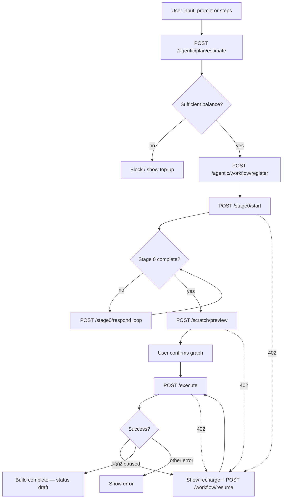

# Workflow Builder — Credit Flow & Frontend Binding (Updated)

**Audience:** Frontend engineers wiring the workflow builder UI after the credit/resume changes.

**Supersedes (partially):** credit sections in `WORKFLOW_BUILDER_BACKEND_FRONTEND_README.md` — especially §7 (Credits), §5 flow order, and pause/resume behavior.

**Companion docs:**
- Full builder integration (canvas, Stage 0, runtime): `WORKFLOW_BUILDER_BACKEND_FRONTEND_README.md`
- Pause/resume deep dive: `WORKFLOW_BUILDER_CREDIT_RESUME_FRONTEND_GUIDE.md`
- Testing: `WORKFLOW_BUILDER_CREDIT_RESUME_TESTING.md`

**Backend source of truth:** `backend/agent_new.py`, `backend/services/workflow_budget_service.py`, `backend/services/build_checkpoint.py`, `backend/services/build_progress.py`

---

## Table of contents

1. [What changed (summary)](#1-what-changed-summary)
2. [New end-to-end flow](#2-new-end-to-end-flow)
3. [Credit & billing model (USD)](#3-credit--billing-model-usd)
4. [New & updated API endpoints](#4-new--updated-api-endpoints)
5. [Frontend binding — screen by screen](#5-frontend-binding--screen-by-screen)
6. [Pause, progress, and resume](#6-pause-progress-and-resume)
7. [MongoDB fields the UI should understand](#7-mongodb-fields-the-ui-should-understand)
8. [HTTP 402 handling](#8-http-402-handling)
9. [Long-running requests](#9-long-running-requests)
10. [TypeScript types](#10-typescript-types)
11. [Frontend migration checklist](#11-frontend-migration-checklist)

---

## 1. What changed (summary)

| Area | Old binding | New binding |
|------|-------------|-------------|
| **Cost preflight** | `/estimate` → `totalCostUsd` only; optional product “credits” | `/estimate` → `predictedCost` (USD cap) + `subscriberAvailableUsd` + `sufficientBalance` |
| **Admission** | Jump straight to Stage 0 / preview | **`POST /workflow/register`** with `predictedCost` and **`reserveSubscriberCredits: true`** **before** any billed LLM step |
| **Preview credit gate** | `minimumCredits` on `/scratch/preview` | **Removed** — billing uses registered `predictedCost` in `Process_Configs` |
| **Execute credit gate** | `estimatedCredits` on request (fallback 50) | Workflow cap from **`Process_Configs.predictedCost`**; charges tracked in `budgetSpentUsd` / `overflowSpentUsd` |
| **Mid-build pause** | Not supported / hold released on error | **402 + checkpoint**; reservation kept; **`POST /workflow/resume`** continues |
| **Pause detection** | `agentic_process.status` only | **`workflow_build_checkpoints`** (primary) + top-level **`creditPauseStatus`** (durable fallback) |
| **Progress UI** | None | **`POST /workflow/progress`** — percent, gap nodes, billing strip |
| **Abandon build** | None | **`POST /workflow/release`** — release unused reservation |
| **List filters** | `preview` \| `draft` | Also `paused_credit`, `building`, `stage0_in_progress` |

**Deprecated on frontend:** `minimumCredits`, scratch `estimatedCredits` as billing truth. Keep `predictedCost` from `/estimate` through register and display billing from server fields only.

---

## 2. New end-to-end flow



### API call order (required)

| Step | User action | Endpoint | Billing |
|------|-------------|----------|---------|
| 1 | Submit workflow idea | `POST /agentic/plan/estimate` | Read-only |
| 2 | Confirm estimate | `POST /agentic/workflow/register` (`reserveSubscriberCredits: true`) | Creates `Process_Configs` cap + subscriber hold |
| 3 | Start clarification | `POST /stage0/start` | LLM → charges cap/wallet |
| 4 | MCQ loop | `POST /stage0/respond` | LLM |
| 5 | Confirm cost screen | *(optional — estimate already shown)* | — |
| 6 | Generate graph | `POST /agentic/plan/scratch/preview` | LLM |
| 7 | Confirm graph | — | — |
| 8 | Generate assets | `POST /agentic/plan/execute` | LLM (long-running) |
| 9 | On 402 | `POST /agentic/workflow/resume` | Continues from checkpoint |
| — | Poll / re-entry | `POST /agentic/workflow/progress` | Read-only |
| — | Abandon | `POST /agentic/workflow/release` | Releases unused hold |

**Stable key:** `projectId` === `workflowId` (same MongoDB document in `Process_Configs`).

---

## 3. Credit & billing model (USD)

Billing is **USD-based**, not opaque product credits.

### Subscriber wallet (`subscribers.AICredits`)

```
available = limit - used - reserved
```

- **Register** (`reserveSubscriberCredits: true`) increments `reserved` by `predictedCost`.
- Each LLM call charges `used` (and decrements `reserved` while under workflow cap).
- On successful build completion, unused hold is released: `predictedCost - budgetSpentUsd`.

### Per-workflow cap (`Process_Configs`)

| Field | Meaning | UI label suggestion |
|-------|---------|---------------------|
| `predictedCost` | Registered budget cap (from `/estimate`) | “Estimated budget” |
| `budgetSpentUsd` | Spend charged **against cap** | “Used (cap)” |
| `overflowSpentUsd` | Spend **after cap exhausted** (wallet-only mode) | “Extra wallet spend” |
| `reservationStatus` | `"active"` \| `"released"` | Internal / badge |
| `creditPauseStatus` | `"paused_credit"` when build paused for billing; else absent | “Paused — credits” |

**Display helpers (server-computed in 402 / progress):**

| Display | Formula |
|---------|---------|
| Total workflow cost | `budgetSpentUsd + overflowSpentUsd` |
| Cap remaining | `max(0, predictedCost - budgetSpentUsd)` |

### Two pause scenarios (cap vs wallet)

Credits can run out in **two different ways**. The backend returns **HTTP 402** for both — the frontend must branch on **`detail.code`** and **`capRemainingUsd`**, not on status code alone.

| | **Workflow cap exhausted** | **Subscriber wallet exhausted** |
|---|---|---|
| **`code`** | `WORKFLOW_BUDGET_EXHAUSTED` | `INSUFFICIENT_SUBSCRIBER_BALANCE` |
| **What ran out** | `Process_Configs`: `budgetSpentUsd >= predictedCost` | `subscribers`: `limit - used - reserved <= 0` |
| **Key signal** | **`capRemainingUsd === 0`** | Often **`capRemainingUsd > 0`** (Scenario B) |
| **Typical cause** | Build used the full registered estimate | Wallet drained (other jobs, low limit, or post-cap wallet-only mode) |

**Scenario B — wallet empty, cap still has room** (`INSUFFICIENT_SUBSCRIBER_BALANCE`, `capRemainingUsd > 0`):

- `budgetSpentUsd < predictedCost` — hold still alive in `AICredits.reserved`
- After top-up + resume, billing continues in **workflow-cap mode** (`budgetSpentUsd` ↑)

**Scenario A — cap fully used** (`WORKFLOW_BUDGET_EXHAUSTED`, `capRemainingUsd === 0`):

- `budgetSpentUsd >= predictedCost` — hold drained; no reservation left
- After top-up + resume, server switches to **wallet-only mode** (`overflowSpentUsd` ↑; cap fields frozen)

Frontend does **not** compute charges or pick billing mode — only displays server values. See [§8](#8-http-402-handling) for handler code and UI copy.

---

## 4. New & updated API endpoints

Base: `{BASE}/aiqod-agent/agent`

### 4.1 `POST /agentic/plan/estimate` (updated response)

**When:** Before register / Stage 0 (after user submits prompt or steps).

**Request:** `AgenticPlanRequest` — same as Stage 0 (no `minimumCredits`).

**New / important response fields:**

```typescript
interface PlanEstimateResponse {
  totalCostUsd: number;           // heuristic total
  predictedCost: number;          // pass to /workflow/register
  stage0CostUsd: number;
  previewCostUsd: number;
  executeCostUsd: number;
  subscriberAvailableUsd?: number;
  sufficientBalance?: boolean;    // available >= predictedCost
  stages: { kind: string; count: number; costUsd: number; rationale?: string }[];
}
```

**UI:** Block “Start build” when `sufficientBalance === false`. Show stage breakdown optional.

---

### 4.2 `POST /agentic/workflow/register` (required)

**When:** Immediately after estimate, once per workflow build.

**Recommended:** Always send **`reserveSubscriberCredits: true`**. With the flag `true`, register verifies wallet balance and increments `subscribers.AICredits.reserved` by `predictedCost`. Default is `false` (Process_Configs only — for legacy queue integrations).

**Request:**

```json
{
  "type": "workflow",
  "projectId": "proj12abc_sb_5beaabd82ac6767c86dc311c",
  "subscriberId": "5beaabd82ac6767c86dc311c",
  "orgId": "...",
  "userId": "...",
  "predictedCost": 1.01,
  "reserveSubscriberCredits": true,
  "workflowName": "Pizza Ordering",
  "totalInputTokens": 120000,
  "totalOutputTokens": 80000
}
```

| Field | Type | Default | Description |
|-------|------|---------|-------------|
| `reserveSubscriberCredits` | boolean | `false` | When `true`, increment `AICredits.reserved`. **Keep `true` in frontend.** |

**Response:**

```json
{
  "success": true,
  "projectId": "proj12abc_sb_...",
  "predictedCost": 1.01,
  "reservedUsd": 1.01,
  "reservationStatus": "active",
  "created": true
}
```

**Errors:**

| HTTP | Meaning |
|------|---------|
| 402 | Wallet overdrawn at register time |
| 400 | Invalid `predictedCost` |
| 409 | Already registered with different `predictedCost` |

**Frontend:** Persist `projectId` / `workflowId` from here for all subsequent calls.

---

### 4.3 `POST /agentic/workflow/release` (new)

**When:** User abandons a queued or paused build.

**Request:** `{ projectId, subscriberId, orgId?, userId? }`

**Effect:** Releases unused hold (`predictedCost - budgetSpentUsd`). Does **not** refund spent amount. Does **not** delete checkpoint.

---

### 4.4 `POST /agentic/workflow/progress` (new)

**When:** Re-open paused workflow, “My workflows” detail, or poll during long build.

**Request:** `{ workflowId, subscriberId, orgId?, userId? }`

**Key response fields for UI:**

| Field | Bind to |
|-------|---------|
| `isPaused` | Show “Paused” banner |
| `canResume` | Enable **Resume build** button |
| `resumeEndpoint` | Always `/aiqod-agent/agent/agentic/workflow/resume` when `canResume` |
| `stoppedAt` | Headline text |
| `overallPercentComplete` | Master progress bar |
| `pipelineStage` | `stage0` \| `preview` \| `execute` |
| `gapProgress` | “2 of 4 screens/tools done” at execute |
| `scratchProgress` | Preview sub-stage detail |
| `billing.*` | Budget strip |
| `remaining.nextStep` | `"resume"` \| `"execute"` \| `"stage0_or_preview"` \| `null` |

**404:** Workflow not registered for tenant.

---

### 4.5 `POST /agentic/workflow/resume` (new)

**When:** After recharge, user clicks **Resume build**.

**Request:** `{ workflowId, subscriberId, orgId?, userId? }` — **no** `phaseGraphs`, no checkpoint payload.

**Success (200):** Same shape as the paused endpoint:

| Paused at | Response type |
|-----------|---------------|
| `stage0` | `Stage0Response` or `Stage0GuidanceResponse` |
| `preview` | `AgenticPlanPreviewResponse` |
| `execute` | `AgenticPlanResponse` |

**402:** Still paused — show recharge modal again.

**400:** No checkpoint (only `creditPauseStatus` without checkpoint) — must re-execute from start.

Route resume response through the **same handlers** as the original endpoint.

---

### 4.6 Updated list filter

`POST /agentic/workflows/list`

```json
{
  "orgId": "...",
  "subscriberId": "...",
  "status": "paused_credit"
}
```

`status` values: `"preview"` \| `"draft"` \| `"paused_credit"` \| `"building"` \| `"stage0_in_progress"` \| `"all"`.

**Note:** List uses `agentic_process.status`. External job runners may overwrite that field. For paused workflows, call **`/workflow/progress`** to get authoritative `canResume`.

---

### 4.7 Wallet read & top-up (new)

**When:** Sidebar credits display, recharge modal after 402, refresh after top-up.

#### `GET /aiqod-agent/agent/credits`

**Query:** `subscriberId` (required), optional `orgId`, `userId`. Header fallback: `x-subscriber-id`.

**Response:**

```json
{
  "success": true,
  "data": {
    "subscriberId": "5beaabd82ac6767c86dc311c",
    "credits": {
      "limit": 150.0,
      "balance": 120.0,
      "used": 30.0,
      "reserved": 10.0,
      "total_purchased": 150.0,
      "total_consumed": 30.0
    },
    "available_credits": 110.0,
    "available_usd": 110.0,
    "currency": "USD"
  }
}
```

`available_credits` = `limit - used - reserved` (same formula as billing checks).

#### `POST /aiqod-agent/agent/credits/top-up`

**When:** User tops up after 402 or from account settings. Increments `subscribers.AICredits.limit` only (does not change `used` or `reserved`).

**Request:**

```json
{
  "subscriberId": "5beaabd82ac6767c86dc311c",
  "amountUsd": 50.0,
  "note": "Dev wallet recharge"
}
```

| Field | Required | Description |
|-------|----------|-------------|
| `subscriberId` | Yes* | Subscriber `_id` |
| `amountUsd` | Yes | Positive USD to add to `AICredits.limit` |
| `note` | No | Optional audit note (max 500 chars) |

\*Can come from `x-subscriber-id` header instead.

**Response (200):** Same wallet snapshot as GET `/credits`, plus:

```json
{
  "success": true,
  "data": {
    "subscriberId": "...",
    "credits": { "...": "..." },
    "available_credits": 160.0,
    "topUp": {
      "amountUsd": 50.0,
      "previousLimitUsd": 100.0,
      "newLimitUsd": 150.0,
      "note": "Dev wallet recharge",
      "toppedUpAt": "2026-07-05T06:10:00"
    }
  }
}
```

**Errors:** `400` (missing subscriber / invalid amount), `404` (subscriber not found).

**Note:** No payment gateway integration yet — wire behind auth or a payment provider before production.

---

## 5. Frontend binding — screen by screen

### Screen 1 — Input

No API change. Build `AgenticPlanRequest` once.

---

### Screen 2 — Estimate & register (new gate)

```typescript
// 1) Estimate
const estimate = await agentPost<PlanEstimateResponse>(
  "/agentic/plan/estimate",
  planInput,
  tenant,
);

if (estimate.sufficientBalance === false) {
  showTopUpUI(estimate.subscriberAvailableUsd, estimate.predictedCost);
  return;
}

await ui.confirmEstimate({
  predictedCost: estimate.predictedCost,
  totalCostUsd: estimate.totalCostUsd,
  stage0: estimate.stage0CostUsd,
  preview: estimate.previewCostUsd,
  execute: estimate.executeCostUsd,
});

// 2) Register (reserveSubscriberCredits: true — no external queue)
const reg = await agentPost<WorkflowRegisterResponse>(
  "/agentic/workflow/register",
  {
    type: "workflow",
    projectId: tenant.projectId,
    subscriberId: tenant.subscriberId,
    orgId: tenant.orgId,
    userId: tenant.userId,
    predictedCost: estimate.predictedCost,
    reserveSubscriberCredits: true,
    workflowName: planInput.selectedName,
    totalInputTokens: estimate.totalInputTokens,
    totalOutputTokens: estimate.totalOutputTokens,
  },
  tenant,
);

saveWorkflowId(reg.projectId);
```

**Remove:** sending `minimumCredits` on preview.

---

### Screen 3–4 — Stage 0

Unchanged UX. Wrap all Stage 0 calls in **402 handler** (§8).

`projectId` on `/stage0/start` must match registered `projectId`.

---

### Screen 5 — Scratch preview

**Request changes:**

| Field | Required | Notes |
|-------|----------|-------|
| `projectId` | Yes | Same as registered workflow |
| `subscriberId` | Yes | |
| `stage0Handoff` | Yes (if Stage 0 ran) | Full `requirementSummary` |
| ~~`minimumCredits`~~ | **No** | Deprecated |

Billing initializes from `Process_Configs.predictedCost` automatically.

---

### Screen 6 — Execute

**Request changes:**

| Field | Required | Notes |
|-------|----------|-------|
| `workflowId` | Yes | From preview |
| `phaseGraphs` | Yes | Verbatim from preview |
| `subscriberId` | Yes | |
| ~~`estimatedCredits`~~ | **Optional / legacy** | Cap comes from DB |

**On success:** status → `draft`, checkpoint deleted, `reservationStatus` → `released` (unused hold returned).

**On 402:** show pause UI; store 402 `detail` or call `/workflow/progress`.

**Duration:** 8–20+ minutes common. See §9.

---

### Screen 7 — Build complete

Unchanged binding — see main README §6.1. Keep `preview.workflowId` (execute response has no `workflowId`).

---

## 6. Pause, progress, and resume

### Status authority (important)

| Source | Role |
|--------|------|
| `workflow_build_checkpoints.status == "paused_credit"` | **Primary** — has full resume context |
| `Process_Configs.creditPauseStatus == "paused_credit"` | **Durable fallback** — survives external overwrites of `agentic_process.status` |
| `Process_Configs.agentic_process.status` | **Do not trust alone** for pause — external job runner may set `Active`, `draft`, etc. |

### What is NOT in `Process_Configs` while paused mid-execute

Partial graphs (`ui:*` / resolved nodes) live in **checkpoint only** until execute completes. Do not rebuild execute payload from `Process_Configs.phaseGraphs` after an execute pause.

### Recommended UI flow on 402

```typescript
async function onWorkflowApiError(err: { status: number; detail: unknown }) {
  if (err.status !== 402) throw err;
  const d = err.detail as WorkflowBillingPauseDetail;

  savePausedState({
    workflowId: d.workflowId!,
    pipelineStage: d.pipelineStage,
    billing: d,
  });

  // Optional: richer progress
  const progress = await loadWorkflowProgress(d.workflowId!);

  showPausedModal({
    headline: progress.stoppedAt ?? d.error,
    percent: progress.overallPercentComplete,
    gapProgress: progress.gapProgress,
    billing: progress.billing,
    canResume: progress.canResume,
  });
}
```

### Resume call

```typescript
async function resumeBuild(tenant: TenantContext) {
  const data = await agentPost<unknown>(
    "/agentic/workflow/resume",
    {
      workflowId: tenant.projectId,
      subscriberId: tenant.subscriberId,
      orgId: tenant.orgId,
      userId: tenant.userId,
    },
    tenant,
  );
  // Dispatch by pipelineStage stored from last 402 / progress
  return data;
}
```

### Poll during long build (optional)

While `phase === "generating"`, poll `/workflow/progress` every 5–10s for `overallPercentComplete` and `gapProgress` (if execute started before UI subscribed to 402).

---

## 7. MongoDB fields the UI should understand

Frontend reads these via API responses — not direct Mongo access.

### `Process_Configs` (via register, progress, 402)

| Field | When set | UI use |
|-------|----------|--------|
| `predictedCost` | Register | Budget cap |
| `budgetSpentUsd` | Each LLM charge under cap | Spent meter |
| `overflowSpentUsd` | After cap exhausted | Extra spend |
| `reservationStatus` | `active` during build; `released` when done | Debug |
| `creditPauseStatus` | `"paused_credit"` on billing pause | Fallback pause badge |
| `agentic_process.status` | `queued` → `building` → `preview` / `draft` / `paused_credit` | List badges (verify with progress) |
| `agentic_process.phaseGraphs` | Preview + final execute only | Canvas (not partial execute state) |

### `workflow_build_checkpoints` (server-only; exposed via progress / 402)

| Field | UI use |
|-------|--------|
| `pipeline_stage` | Where to resume |
| `phase_index` / `phase_total` | Phase progress |
| `phase_graphs` | Partial execute graphs |
| `last_error.node_id` | “Paused while generating X” |
| `scratch_state.sub_stage` | Preview sub-step |

---

## 8. HTTP 402 handling

All billing failures return **402** with a structured JSON body (FastAPI billing handlers put fields at the top level, not nested under `detail`).

### 8.1 Error codes

| `code` | Meaning | Typical user message |
|--------|---------|----------------------|
| `WORKFLOW_BUDGET_EXHAUSTED` | Cap spent (`budgetSpentUsd >= predictedCost`) | “Workflow estimate fully used — top up to continue” |
| `INSUFFICIENT_SUBSCRIBER_BALANCE` | Wallet empty (`limit - used - reserved <= 0`) | “Account balance empty — top up to continue” |
| `WORKFLOW_NOT_REGISTERED` | Missing `/workflow/register` | “Register workflow first” |
| `PREDICTED_COST_MISSING` | Bad register payload | Fix client payload |

Use **`capRemainingUsd`** as a second signal (see [§3](#3-credit--billing-model-usd)):

- **`capRemainingUsd > 0`** → Scenario B — cap still has room; wallet needs top-up
- **`capRemainingUsd === 0`** → Scenario A — cap fully consumed; resume bills wallet only

### 8.2 Endpoints that can 402

| Endpoint | Checkpoint on 402? | Typical `code` |
|----------|-------------------|----------------|
| `/stage0/start`, `/respond`, `/guidance` | Yes | Either |
| `/scratch/preview` | Yes | Either |
| `/execute` | Yes | Either |
| `/workflow/resume` | Yes (still paused) | Either |
| `/workflow/register` | **No** | Usually `INSUFFICIENT_SUBSCRIBER_BALANCE` |

When a checkpoint exists, 402 is enriched with:

| Field | Description |
|-------|-------------|
| `resumeEndpoint` | Always `"/aiqod-agent/agent/agentic/workflow/resume"` |
| `workflowId` | Workflow to resume |
| `status` | `"paused_credit"` |
| `pipelineStage` | `"stage0"` \| `"preview"` \| `"execute"` |
| `phaseIndex` / `phaseTotal` | Phase progress |
| `lastError` | `{ code, phase_id?, node_id?, at }` |
| `predictedCost`, `budgetSpentUsd`, `overflowSpentUsd`, `totalWorkflowSpentUsd`, `capRemainingUsd` | Billing strip |
| `available_usd`, `required_usd` | Present on `INSUFFICIENT_SUBSCRIBER_BALANCE` |

### 8.3 Universal 402 handler (recommended)

```typescript
async function onWorkflowApiError(err: { status: number; body: unknown }) {
  if (err.status !== 402) throw err;
  const d = err.body as WorkflowBillingPauseDetail;

  if (d.resumeEndpoint && d.workflowId) {
    // Mid-build pause — checkpoint exists
    savePausedState({ workflowId: d.workflowId, pipelineStage: d.pipelineStage, billing: d });

    const progress = await loadWorkflowProgress(d.workflowId); // optional, richer UI

    showPausedModal({
      code: d.code,
      headline: progress.stoppedAt ?? d.error,
      workflowId: d.workflowId,
      pipelineStage: d.pipelineStage,
      phaseIndex: d.phaseIndex,
      phaseTotal: d.phaseTotal,
      nodeId: d.lastError?.node_id,
      billing: {
        predictedCost: d.predictedCost,
        budgetSpentUsd: d.budgetSpentUsd,
        capRemainingUsd: d.capRemainingUsd,
        overflowSpentUsd: d.overflowSpentUsd,
      },
      availableUsd: d.available_usd,
      requiredUsd: d.required_usd,
      canResume: progress.canResume,
    });
  } else {
    // Pre-build (usually /workflow/register) — no checkpoint
    showTopUpModal({
      code: d.code,
      requiredUsd: d.required_usd,
      availableUsd: d.available_usd,
    });
  }
}
```

### 8.4 UI copy by scenario

| Condition | User-facing message | What to show |
|-----------|---------------------|--------------|
| `code === 'WORKFLOW_BUDGET_EXHAUSTED'` | “This workflow’s estimated budget is used up. Top up your account to continue — extra cost will come from your wallet.” | `budgetSpentUsd / predictedCost`, `capRemainingUsd: 0` |
| `code === 'INSUFFICIENT_SUBSCRIBER_BALANCE'` && `capRemainingUsd > 0` | “Account balance empty, but this workflow still has budget left. Top up to continue.” | `capRemainingUsd`, `available_usd` |
| `code === 'INSUFFICIENT_SUBSCRIBER_BALANCE'` && `capRemainingUsd === 0` | “Account balance empty — top up to continue.” | Wallet via `GET /credits` |

Progress line (when checkpoint exists):

> “Paused at phase {phaseIndex + 1} of {phaseTotal}”  
> optionally: “while generating **{lastError.node_id}**”

### 8.5 Recharge action (both scenarios)

Top up the **subscriber wallet** — not the per-workflow cap. The frontend does **not** need to extend `predictedCost` or re-estimate.

```typescript
async function topUpWallet(subscriberId: string, amountUsd: number) {
  await agentPost("/aiqod-agent/agent/credits/top-up", { subscriberId, amountUsd });
  return agentGet("/aiqod-agent/agent/credits", { subscriberId }); // refresh sidebar
}
```

See [§4.7](#47-wallet-read--top-up-new) for full request/response shapes.

### 8.6 Resume after top-up (both scenarios — same endpoint)

After top-up, always call **`POST /agentic/workflow/resume`** with `{ workflowId, subscriberId, orgId?, userId? }`.

The server picks billing mode automatically via `init_billing_for_resume()`:

| After pause | Server mode on resume | What increases on next LLM calls |
|-------------|----------------------|----------------------------------|
| Scenario B (`capRemainingUsd > 0`) | Workflow-cap mode | `budgetSpentUsd` |
| Scenario A (`capRemainingUsd === 0`) | Wallet-only mode | `overflowSpentUsd` |

If wallet is still empty → **402 again** → show top-up modal → retry **same resume payload**.

**Register-only 402:** If 402 hits on **`POST /workflow/register`** (no `resumeEndpoint`), top up then **retry `/register`** — do **not** call `/resume`.

### 8.7 Do / Don't

| Do | Don't |
|----|-------|
| Branch on `detail.code` + `capRemainingUsd` | Treat all 402s as generic “out of credits” |
| Top up wallet → `/resume` when `resumeEndpoint` is present | Re-call `/execute` or `/register` after mid-build pause |
| Handle 402 on `/resume` (recharge loop) | Re-estimate or bump `predictedCost` from the frontend |
| Show billing from server fields | Compute billing client-side |
| Refresh sidebar via `GET /credits` after top-up | Assume top-up changes `Process_Configs.predictedCost` |

### 8.8 Example 402 (execute pause — cap exhausted)

```json
{
  "success": false,
  "error": "Workflow budget exhausted (12.5000 / 12.5000 USD).",
  "code": "WORKFLOW_BUDGET_EXHAUSTED",
  "resumeEndpoint": "/aiqod-agent/agent/agentic/workflow/resume",
  "workflowId": "test39_sb_5beaabd82ac6767c86dc316c",
  "status": "paused_credit",
  "pipelineStage": "execute",
  "phaseIndex": 0,
  "phaseTotal": 1,
  "lastError": {
    "code": "WORKFLOW_BUDGET_EXHAUSTED",
    "phase_id": "phase_1",
    "node_id": "validate_applicant_data",
    "at": "2026-06-29T12:07:07.066000"
  },
  "predictedCost": 12.5,
  "budgetSpentUsd": 12.5,
  "overflowSpentUsd": 0,
  "totalWorkflowSpentUsd": 12.5,
  "capRemainingUsd": 0
}
```

### 8.9 Example 402 (wallet empty — cap still has room, Scenario B)

```json
{
  "success": false,
  "error": "Subscriber balance exhausted (limit - used - reserved).",
  "code": "INSUFFICIENT_SUBSCRIBER_BALANCE",
  "available_usd": 0,
  "required_usd": 0,
  "resumeEndpoint": "/aiqod-agent/agent/agentic/workflow/resume",
  "workflowId": "test39_sb_5beaabd82ac6767c86dc316c",
  "status": "paused_credit",
  "pipelineStage": "execute",
  "phaseIndex": 0,
  "phaseTotal": 1,
  "predictedCost": 12.5,
  "budgetSpentUsd": 8.0,
  "overflowSpentUsd": 0,
  "totalWorkflowSpentUsd": 8.0,
  "capRemainingUsd": 4.5
}
```

---

## 9. Long-running requests

`/execute` and `/workflow/resume` (when resuming execute) are **synchronous HTTP** calls that may run **8–20+ minutes**.

| Layer | Recommendation |
|-------|----------------|
| **HTTP client** | Timeout ≥ 60 minutes (`fetch` / axios / Postman) |
| **UI** | Non-dismissible progress; disable double-submit |
| **Progress** | Poll `/workflow/progress` or show indeterminate + phase hints |
| **Proxy** | Ensure nginx `proxy_read_timeout` ≥ 3600s on agent routes |
| **Future** | Consider async job + poll pattern for production UX |

**Verified behavior:** Server completes and returns `200` with `Content-Length` JSON; client/proxy timeouts can make it *appear* hung even when build succeeded (check `/workflow/progress` or workflow list if unsure).

---

## 10. TypeScript types

```typescript
export interface TenantContext {
  projectId: string;
  orgId: string;
  subscriberId: string;
  userId: string;
}

export interface WorkflowRegisterRequest {
  type: "workflow";
  projectId: string;
  subscriberId: string;
  predictedCost: number;
  /** Keep true — reserves subscriber hold in the same call. */
  reserveSubscriberCredits?: boolean;
  orgId?: string;
  userId?: string;
  workflowName?: string;
  totalInputTokens?: number;
  totalOutputTokens?: number;
}

export interface WorkflowProgressResponse {
  success: boolean;
  found: boolean;
  workflowId: string;
  workflowName?: string;
  workflowStatus?: string;
  isPaused: boolean;
  canResume: boolean;
  resumeEndpoint?: string;
  stoppedAt?: string;
  pipelineStage?: "stage0" | "preview" | "execute";
  overallPercentComplete: number;
  gapProgress: {
    total: number;
    resolved: number;
    remaining: number;
    percentComplete: number;
    resolvedNodes: GapNode[];
    remainingNodes: GapNode[];
  };
  billing: {
    predictedCost: number;
    budgetSpentUsd: number;
    overflowSpentUsd: number;
    totalWorkflowSpentUsd: number;
    capRemainingUsd: number;
    reservationStatus?: string;
  };
  remaining: {
    nextStep?: "resume" | "execute" | "stage0_or_preview" | null;
    gapNodesRemaining: number;
    capRemainingUsd: number;
  };
}

export type BillingErrorCode =
  | "WORKFLOW_BUDGET_EXHAUSTED"
  | "INSUFFICIENT_SUBSCRIBER_BALANCE"
  | "WORKFLOW_NOT_REGISTERED"
  | "PREDICTED_COST_MISSING";

export interface WorkflowBillingPauseDetail {
  success: false;
  error: string;
  code: BillingErrorCode;
  resumeEndpoint?: string;
  workflowId?: string;
  pipelineStage?: "stage0" | "preview" | "execute";
  phaseIndex?: number;
  predictedCost?: number;
  budgetSpentUsd?: number;
  overflowSpentUsd?: number;
  totalWorkflowSpentUsd?: number;
  capRemainingUsd?: number;
  available_usd?: number;
  required_usd?: number;
  lastError?: { code: string; phase_id?: string; node_id?: string; at?: string };
}

export interface SubscriberCreditsTopUpRequest {
  subscriberId: string;
  amountUsd: number;
  note?: string;
}

export interface SubscriberCreditsResponse {
  subscriberId: string;
  credits: {
    limit: number;
    balance: number;
    used: number;
    reserved: number;
    total_purchased: number;
    total_consumed: number;
  };
  available_credits: number;
  available_usd: number;
  currency: "USD";
  topUp?: {
    amountUsd: number;
    previousLimitUsd: number;
    newLimitUsd: number;
    note?: string;
    toppedUpAt: string;
  };
}
```

---

## 11. Frontend migration checklist

- [ ] Register with **`reserveSubscriberCredits: true`** (no queue step)
- [ ] Pass `predictedCost` from estimate to register (not `minimumCredits` to preview)
- [ ] Remove `minimumCredits` from preview payload
- [ ] Remove reliance on scratch `estimatedCredits: 0` for billing display
- [ ] Global **402 handler** on stage0, preview, execute, resume — branch on `code` + `capRemainingUsd` (§8)
- [ ] **Top-up flow:** `POST /credits/top-up` → refresh `GET /credits` → `POST /workflow/resume`
- [ ] **Paused workflow** screen using `/workflow/progress` + **Resume** → `/workflow/resume`
- [ ] List filter `status: "paused_credit"` + progress verification for `canResume`
- [ ] Budget strip from `billing` on progress / 402 (not client-side math)
- [ ] Long HTTP timeout on execute/resume; progress polling optional
- [ ] Do **not** re-call `/execute` with old preview graphs after execute pause
- [ ] Do **not** use `agentic_process.status` alone to detect pause — use `canResume` from progress
- [ ] Abandon flow → `/workflow/release` when user cancels queued/paused build

---

## Quick endpoint reference

| Method | Path | Purpose |
|--------|------|---------|
| POST | `/agentic/plan/estimate` | USD preflight + `predictedCost` |
| POST | `/agentic/workflow/register` | Create workflow cap; use `reserveSubscriberCredits: true` |
| POST | `/agentic/workflow/release` | Release unused reservation |
| POST | `/agentic/workflow/progress` | Build status + billing + resume hints |
| POST | `/agentic/workflow/resume` | Continue after 402 |
| POST | `/stage0/start` | Stage 0 (requires register) |
| POST | `/agentic/plan/scratch/preview` | Graph preview |
| POST | `/agentic/plan/execute` | Gap resolution + codegen |
| POST | `/agentic/workflows/list` | My workflows (incl. `paused_credit`) |
| GET | `/aiqod-agent/agent/credits` | Subscriber wallet snapshot (sidebar) |
| POST | `/aiqod-agent/agent/credits/top-up` | Top up wallet (`AICredits.limit`) |
